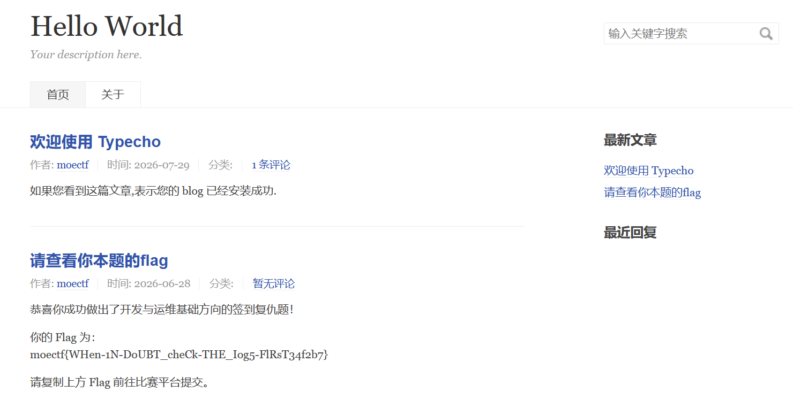

# 出题文档与题解

## 当Nginx不在家（工具使用 / 按顺序发送 flag 碎片）

```bash
docker build -t my-custom-app:v1.0 .
docker run -d -p 8080:3000 --name my-running-app my-custom-app:v1.0
```

给个服务器，有一个脚本定时向x.x.x.x:3000/flag发请求，依次是

```
{“ch”: “moe”}
{“ch”: “ct”}
{“ch”: “f{xx}”}
```

发请求的间隔为10秒，这样部署好服务之后最慢10秒就可以从日志或者控制台找到flag。   
nginx可以设置log format，这样只要装一个nginx就可以了。   
也可以用flask啥的listen一下3000，然后看看控制台的输出。   
失算了，不让连外网，原本还打算弄得开放一点的。   

题解：

```bash
while true; do nc -l -p 3000 | grep "ch"; done
```

```bash
perl -MIO::Socket::INET -e '$s=IO::Socket::INET->new(LocalPort=>3000,Listen=>5,Reuse=>1); while($c=$s->accept()){print<$c>; close$c}'
```

## 代号：碎片风暴（高并发解析 flag）

比如对于这个flag moectf{you_are_so_smart}   
有的会发送tf{you   
有的发送e_s   
有的发送ectf   
请求当中只有碎片的内容，没有序号、偏移量，需要用最短公共超串之类的东西来做。   
程序需要把这些碎片尽可能高效地拼起来，不高效的话等会被高并发打爆了（   

本题的题面经过删改，原先的题面在`../../challenges/devops/storm-of-messages/original.md`。

题解：

可以写代码，亦可参考前面题目用nc监听一小段时间然后手动拼接。

```python
import threading
from flask import Flask, request

app = Flask(__name__)

fragments_list = []
list_lock = threading.Lock()

THRESHOLD = 100

# 这个在题面里有
def solve_scs(fragments: list[str]) -> tuple[str, bool]:
    return "example", True

@app.route('/', methods=['POST'])
def handle():
    global fragments_list
    
    fragment = request.get_data(as_text=True)
    
    if not fragment:
        return "Empty Fragment", 400

    with list_lock:
        fragments_list.append(fragment)

        if len(fragments_list) >= THRESHOLD:
            current_fragments = fragments_list.copy()
            fragments_list = []
            
            flag, isSuccess = solve_scs(current_fragments)
            if isSuccess:
                print(f"Flag found: {flag}")
                return flag, 200
            else:
                print("Merge failed")
        
    return "OK"

if __name__ == '__main__':
    app.run(host='0.0.0.0', port=3000, threaded=True, debug=False)
```

## 网站日志取证大师

这里有一个使用 WordPress 搭建的博客，附件为该博客 6 个小时内的网站日志。网站使用 CDN，源 IP 被 CDN 添加到 HTTP 头部。博客域名为www.blog.moectf和blog.moectf，源服务器 IP 为10.0.0.1（为避免使用公网 IP 引入的额外风险，本题使用内网 IP 来指代真实的公网 IP）
请你对该日志进行分析，回答以下问题：   
本日志中所有 IP 一共向/wp-json/wp/v2/users/me路由枚举了多少个不同用户名？（int，不带前缀零，不算空白请求）
通过分析请求特征，185.177.72.68这个 IP 使用什么工具（名称/版本号，请以 User-Agent 原始内容为准）对网站进行扫描？在日志记录的这段时间里一共扫描了多少次？在 08/Jul/2026:00:08:07 +0800 左右，该 IP 在探测哪一个漏洞是否可利用（CVE漏洞编号）？扫描的起止时间为？（hhmmdd，若从东8时区的当日23时20分40秒至次日0时8分23秒，则为232040-000823）   
请将以上问题的答案写为flag提交，不同问题的答案用连字符连接。   
例如moectf{52-python-requests/2.32.4-3000-CVE-2026-43284-232040-000823}。 

题解：   
moectf{11-curl/8.7.1-2214-CVE-2017-9841-235216-000808}   
共 11 个，分别是 asq ahu \xE6\x9E\x97\xE6\x9E\x97 linlinzzo xxx foobar deqaz aabbcc bbccdd ccddff ddffee   
使用curl/8.7.1，一共进行了 2214 次扫描，企图利用 CVE-2017-9841 php-unit 远程代码执行漏洞，起止时间为235216-000808   

## 运维入门指北_revenge

查看日志，发现配置文件里面有两处错误，一个是sock地址填错了，一个是script_filename被注释了。

2026/07/29 01:43:10 [crit] 313#313: 1 connect() to **unix:/run/php/php-fpm.sock** failed (2: **No such file or directory**) while connecting to upstream, client: 127.0.0.1, server: blog.moectf, request: "GET / HTTP/1.1", upstream: "fastcgi://unix:/run/php/php-fpm.sock:", host: "blog.moectf"

改完之后systemctl restart nginx，访问博客网站就进入到安装程序。但安装程序提示./upload文件夹的权限有问题“上传目录无法写入, 请手动将安装目录下的 /usr/uploads 目录的权限设置为可写然后继续升级”，检查一下，修复文件夹的属主。

完成安装程序后，博客首页可能会因为安装过程中的问题出现Server Error，此时在`config.inc.php`中添加：

```php
define('__TYPECHO_DEBUG__', true);
```

再访问博客首页，就可以看到包含flag的一篇文章。



为什么这里的sock地址不填版本号又不行了呢？因为人工把软连接删除了。

### 验题题解 by Zero6Six

网页访问出现 502 Bad Gateway，检查 Nginx 日志 `/srv/blog/logs/error.log`：

```log
2026/08/14 05:36:20 [crit] 288#288: *43 connect() to unix:/run/php/php-fpm.sock failed (2: No such file or directory) while connecting to upstream, client: 127.0.0.1, server: blog.moectf, request: "GET / HTTP/1.1", upstream: "fastcgi://unix:/run/php/php-fpm.sock:", host: "127.0.0.1:8080"
```

这个错误表示 Nginx 尝试通过 Unix Socket 连接 PHP-FPM 进程，但 socket 文件 `/run/php/php-fpm.sock` 不存在。

```sh
~$ ls /run/php
php8.4-fpm.pid  php8.4-fpm.sock

~$ systemctl list-units | grep php
php8.4-fpm.service      loaded inactive dead    The PHP 8.4 FastCGI Process Manager
phpsessionclean.service loaded inactive dead    Clean php session files
phpsessionclean.timer   loaded unknown dead     Clean PHP session files every 30 mins
```

查看并重启这个服务试试：

```sh
~$ systemctl status php8.4-fpm.service
php8.4-fpm.service - The PHP 8.4 FastCGI Process Manager
    Loaded: loaded (/usr/lib/systemd/system/php8.4-fpm.service, enabled)
    Active: inactive (dead)

~$ sudo systemctl start php8.4-fpm.service
WARNING:systemctl: php8.4-fpm.service: the use of /bin/kill is not recommended for Service ExecReload as it is asynchronous.
                        That means all the dependencies will perform the reload simultaneously / out of order.
WARNING:systemctl:notify start not active

~$ systemctl status php8.4-fpm.service
php8.4-fpm.service - The PHP 8.4 FastCGI Process Manager
    Loaded: loaded (/usr/lib/systemd/system/php8.4-fpm.service, enabled)
    Active: inactive (dead)
```

启动不起来，继续查日志：

```sh
~$ sudo cat /var/log/php8.4-fpm.log 
[14-Aug-2026 05:47:20] NOTICE: fpm is running, pid 256
[14-Aug-2026 05:47:20] NOTICE: ready to handle connections
[14-Aug-2026 05:47:20] NOTICE: systemd monitor interval set to 10000ms
[14-Aug-2026 05:47:20] NOTICE: Finishing ...
[14-Aug-2026 05:47:20] NOTICE: exiting, bye-bye!
[14-Aug-2026 05:47:20] NOTICE: fpm is running, pid 274
[14-Aug-2026 05:47:20] NOTICE: ready to handle connections
[14-Aug-2026 05:47:20] NOTICE: systemd monitor interval set to 10000ms
[14-Aug-2026 05:51:58] ERROR: Another FPM instance seems to already listen on /run/php/php8.4-fpm.sock
[14-Aug-2026 05:51:58] ERROR: FPM initialization failed
```

发现还有一个实例，`ps aux` 查下进程列表，然后给他杀掉，再重启：

```sh
~$ ps aux | grep php-fpm
root         274  0.0  0.0 255788 10956 ?        Ss   05:47   0:00 php-fpm: master process (/etc/php/8.4/fpm/php-fpm.conf)
www-data     275  0.0  0.0 256192 13932 ?        S    05:47   0:00 php-fpm: pool www
www-data     276  0.0  0.0 256192 13832 ?        S    05:47   0:00 php-fpm: pool www
moeops      3600  0.0  0.0   3500  1980 pts/0    S+   05:53   0:00 grep php-fpm

~$ sudo pkill -9 php-fpm
~$ sudo systemctl start php8.4-fpm.service
WARNING:systemctl: php8.4-fpm.service: the use of /bin/kill is not recommended for Service ExecReload as it is asynchronous.
    That means all the dependencies will perform the reload simultaneously / out of order.

~$ sudo systemctl status php8.4-fpm
php8.4-fpm.service - The PHP 8.4 FastCGI Process Manager
    Loaded: loaded (/usr/lib/systemd/system/php8.4-fpm.service, disabled)
    Active: active (running)
~$ # sudo systemctl enable php8.4-fpm # 开机启动
```

然后网页端就能用了，但是有权限问题。

网站文件的地址在 `/var/www/html/`，进去 `ls -la` 看下权限情况：

```sh
/var/www/html$ ls -la
total 112
drwxr-xr-x 1 www-data www-data  4096 Aug 13 03:26 .
drwxr-xr-x 1 root     root      4096 Aug 13 03:26 ..
-rw-r--r-- 1 www-data www-data 14974 Jan 20  2026 LICENSE.txt
drwxr-xr-x 5 www-data www-data  4096 Jan 20  2026 admin
-rw-r--r-- 1 www-data www-data   615 Aug 13 03:26 index.nginx-debian.html
-rw-r--r-- 1 www-data www-data   720 Jan 20  2026 index.php
drwxr-xr-x 2 www-data www-data  4096 Jan 20  2026 install
-rw-r--r-- 1 www-data www-data 51045 Jan 20  2026 install.php
drwx------ 1 root     root      4096 Jan 20  2026 usr
drwxr-xr-x 6 www-data www-data  4096 Jan 20  2026 var
```

关于文件和文件夹权限，你可以看看 [Linux 101](https://101.lug.ustc.edu.cn/Ch05/#file-permission)，关于本题，注意到 usr 目录的权限位是：`drwx------`（表示仅所有者可以 r 列出目录内容，w 增删改子文件或目录，x 进入该目录），然后这个目录的所有者和用户组都是 `root`。

因此我们需要将其改成类似 `drwxr-xr-x`，所有者和组都为 `www-data` 的样子，这样做权限管理。这里我们使用 [chown](https://tldr.inbrowser.app/pages.zh/common/chown) 和 [chmod](https://tldr.inbrowser.app/pages.zh/common/chmod) 两个命令。

```sh
/var/www/html$ sudo chown -R www-data:www-data usr
# 这里 -R 表示 recursive 递归，因为子文件夹也是 root 所有的，得改掉
/var/www/html$ ls -la
total 112
drwxr-xr-x 1 www-data www-data  4096 Aug 13 03:26 .
drwxr-xr-x 1 root     root      4096 Aug 13 03:26 ..
-rw-r--r-- 1 www-data www-data 14974 Jan 20  2026 LICENSE.txt
drwxr-xr-x 5 www-data www-data  4096 Jan 20  2026 admin
-rw-r--r-- 1 www-data www-data   615 Aug 13 03:26 index.nginx-debian.html
-rw-r--r-- 1 www-data www-data   720 Jan 20  2026 index.php
drwxr-xr-x 2 www-data www-data  4096 Jan 20  2026 install
-rw-r--r-- 1 www-data www-data 51045 Jan 20  2026 install.php
drwx------ 1 www-data www-data  4096 Jan 20  2026 usr
drwxr-xr-x 6 www-data www-data  4096 Jan 20  2026 var

/var/www/html$ sudo chmod +rx usr
/var/www/html$ ls -ld usr
drwxr-xr-x 1 www-data www-data 4096 Jan 20  2026 usr
```

然后在网页中按照给出的数据库配置安装 Typecho 即可。