# MoeCTF 2026 SandBox Official Write Up

出题人（按字典序，不区分大小写）: CloverDayssss,fanchai,linlin,PatriciaOfEndsandtea,starwalking,xing

## 目录

- [MISC入门指北](#misc入门指北)
- [Tomato](#tomato)
- [ez_BASE](#ez_base)
- [ez_LSB](#ez_lsb)
- [星走路的旅程-level1](#星走路的旅程-level1)
- [空白文档](#空白文档)
- [Can_you_find_it?](#can_you_find_it)
- [Pixel_Art](#pixel_art)
- [Polyglot](#polyglot)
- [ez_BASE_revenge](#ez_base_revenge)
- [一线生机](#一线生机)
- [你会git吗？](#你会git吗)
- [半部电台](#半部电台)
- [星走路的旅程-level2](#星走路的旅程-level2)
- [西复问答](#西复问答)
- [霜雪千年](#霜雪千年)
- [Wedge in the Wire](#wedge-in-the-wire)
- [ez_keyboard](#ez_keyboard)
- [一部电台](#一部电台)
- [命运从未公平](#命运从未公平)
- [星走路的黑历史](#星走路的黑历史)
- [胡言乱语](#胡言乱语)
- [kirakira](#kirakira)
- [基米文件](#基米文件)
- [星走路的旅程-level3](#星走路的旅程-level3)
- [魔理沙偷走了重要的东西](#魔理沙偷走了重要的东西)


## MISC入门指北  

### Info  
分数 : 50pts  
出题人 : xing  
题目路径 : [MISC入门指北](../../challenges/misc/MISC入门指北/)

### Explain  

ctrl + A 进行全选，我们发现原本看似空白的地方存在文字

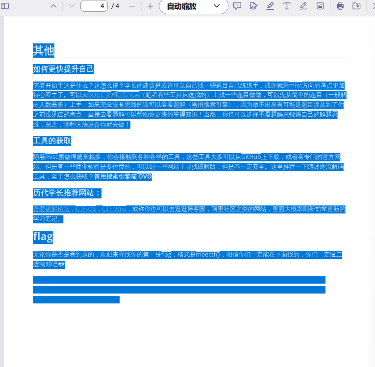  

提取出来如下  
```text
01101101 01101111 01100101 01100011 01110100 01100110 01111011 01010111 00110011 00110001
01100011 00110000 01101101 01100101 01011111 00110111 01101111 01011111 01101101 00110001
00110101 01100011 01111101

```

是一对二进制，我们将其视作ascii进行解码，对照ascii表进行解码，得到flag  
```text
moectf{W31c0me_7o_m15c}
```

## Tomato  

### Info  
分数 : 50pts  
出题人 : starwalking  
题目路径 : [Tomato](../../challenges/misc/Tomato/)

### Explain  

运用一下搜索引擎，即可发现我们需要的解密网站——[小番茄混淆](https://xiaofanqiehunxiao.com/)

但是我们如论如何解混淆都无法解密  

换个思路，我们尝试混淆，就发现了flag  


由于字体的原因可能看不清，多试验几次即可  

```text
moectf{Tom@t0_i5_D3lic1ou5!}
```

## ez_BASE 

### Info
分数 : 50pt  
出题人 : CloverDayssss 
题目路径 : [ez_BASE](../../challenges/misc/ez_BASE/)

### Explain

我们有一段纯文本  

```text
=0HN2U0cAJ2XudHMut2XzYHQo9Vdwk1emR3Yl9Wb
```

特征是base64的，但是 "=" 字符在开头，我们猜测其进行了反转，利用[CyberChef](https://cyberchef.org/)解一下得到flag  

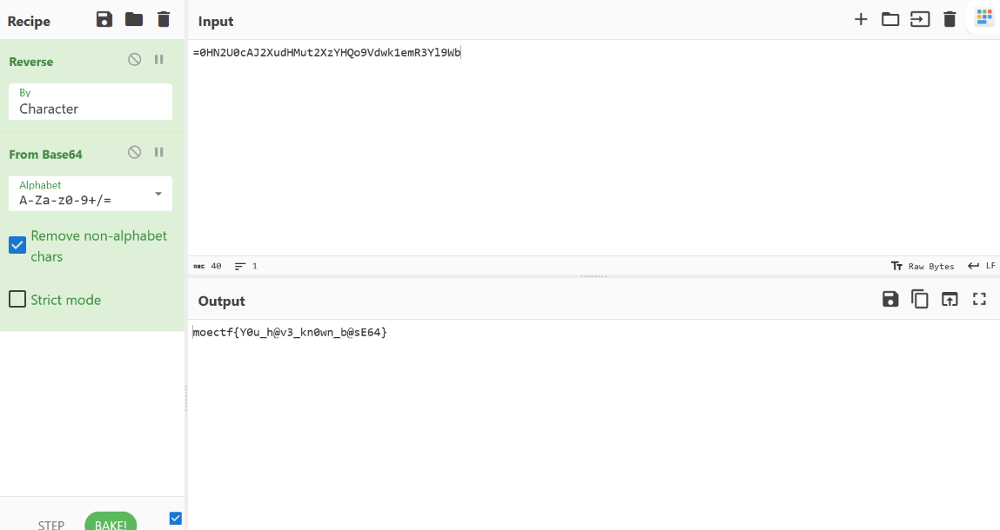  

```text
moectf{Y0u_h@v3_kn0wn_b@sE64}
```

## ez_LSB  

### Info
分数 : 50pts  
出题人 : xing  
题目路径 : [ez_LSB](../../challenges/misc/ez_LSB/)

### Explain

依据题目名字，我们得知是LSB，选取在线网站[stegonline]进行解密吧  

勾选 R0,G0,B0 三个通道，看到了flag字样  

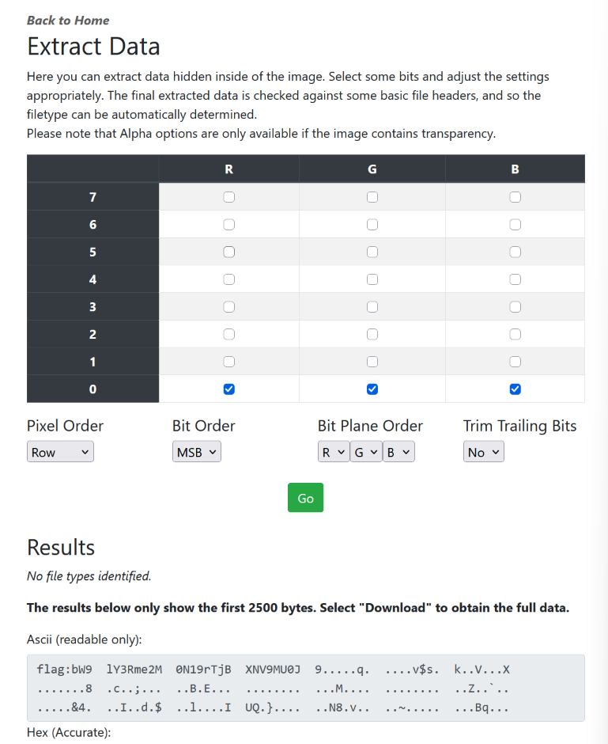  

提取从flag开始可见的连续文本  

```text
bW9lY3Rme2M0N19rTjBXNV9MU0J9
```

再次利用[CyberChef](https://cyberchef.org/)解密即可，得到flag如下  

```text
moectf{c47_kN0W5_LSB}
```

此外，我们采取stegsolve，zsteg等软件一样可以得到结果  

## 星走路的旅程-level1  

### Info
分数 : 50pts  
出题人 : starwalking  
题目路径 : [星走路的旅程-level1](../../challenges/misc/星走路的旅程-level1/)

### Explain

查看图片属性可知手机的型号为 `REDMI K80 Ultra`，对应手机厂商为小米
经纬度为 26°33′,106°47′，可得知是贵州省龙洞堡机场  
拍摄时间为2026年5月31日10时03分  

我们将时间转化成格林尼治标准时间，将flag进行拼接即可  

```text
moectf{KWE_XIAOMI_0203}
```

## 空白文档  

### Info
分数 : 50pts  
出题人 : xing  
题目路径 : [空白文档](../../challenges/misc/空白文档/)

### Explain

和misc入门指北如出一辙，我们进行ctrl + A 全选发现有文字，提取出来如下  

```text
你知道异或吗？key：office
```

key知道了，明文呢？  

word 的本质是压缩包，解压一下  
我们最终在 word/document.xml 中发现了一段疑似base64 的文字  

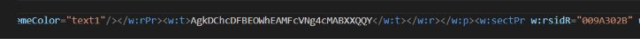

提取出来  

```
AgkDChcDFBEOWhEAMFcVNg4cMABXXQQY
```

进行base64解密后得到的是一串乱码，我们更具提示异或，选择key为office即可得到正确的flag  

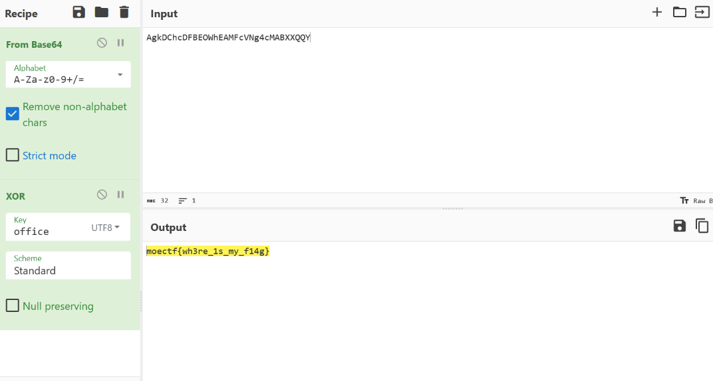


## Can_you_find_it?  

### Info
分数 : 100pts  
出题人 : xing  
题目路径 : [Can_you_find_it?](../../challenges/misc/Can_you_find_it/)

### Explain

题目附件是一个.tar文件，题目又明确说明是Docker镜像，我们先用命令`docker load -i can_you_find_it.tar`加载镜像  

随后命令`docker run -it can_you_find_it`进入  

进入后ls，查看当前目录下有什么文件，发现hint1.txt  

文件内容如下  

```text
xing的hint：或许你可以查一下系统缓存？
```

linux的系统持久缓存区在`/var/cache`,我们 `cd` 过去，再次`ls`发现了hint2.txt

文件内容如下

```text
注意隐藏
```

这告诉我们可能有隐藏文件，我们执行`ls -a `,发现隐藏的`.system`目录  

`cd` 进入继续 `ls -a`找到`cache_meta.log`文件

直接`cat` 发现了很明显的 png 头，我们将其从容器中复制出来


用`docker cp <IMAGE ID>:/var/cache/.system/cache_meta.log ./flag.png`将文件复制出来

查看发现是缺少定位符的二维码，手动补充定位符如下

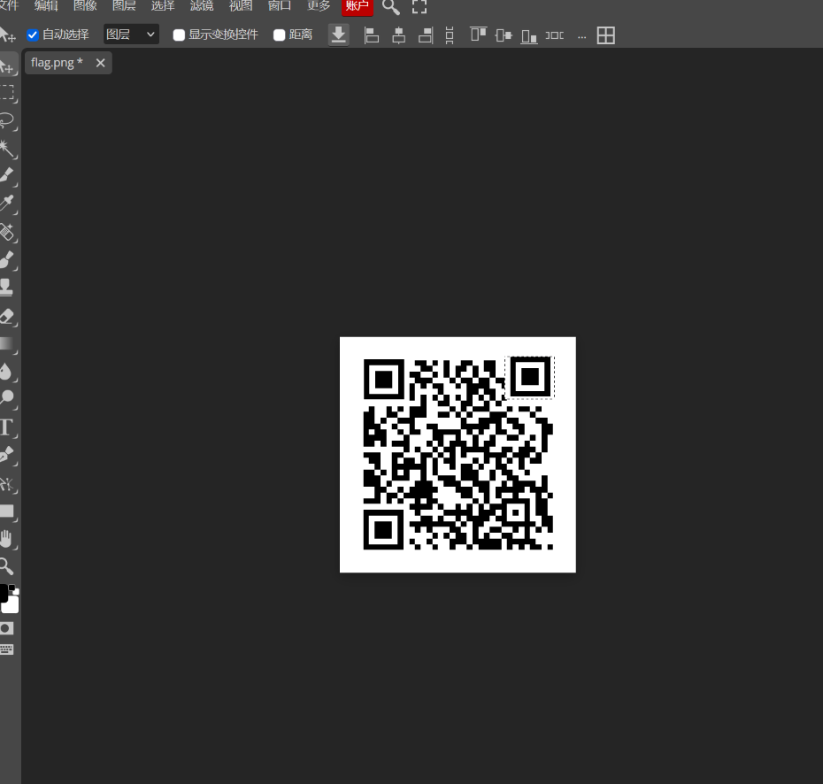

进行扫码即可  

```flag
moectf{1n_7h3_1m4g3_cach3}
```

## Pixel_Art  

### Info
分数 : 100pts  
出题人 : xing  
题目路径 : [Pixel_Art](../../challenges/misc/Pixel_Art/)

### Explain

按照提示，我们猜测这是一个像素图，我们写个脚本进行还原  

```python
from PIL import Image

data = {
    1: [25, 31, 32, 36, 37, 40, 43, 44, 45, 46, 47, 55, 56, 57, 58, 59, 61, 69, 98, 106, 120, 129, 138, 139, 140, 143, 144],
    2: [25, 30, 35, 43, 59, 61, 68, 69, 97, 98, 106, 120, 128, 129, 137, 141, 145],
    3: [0, 1, 3, 7, 8, 9, 13, 14, 15, 19, 20, 21, 24, 25, 26, 29, 30, 31, 35, 39, 40, 43, 44, 45, 46, 58, 61, 62, 63, 64, 69, 74, 75, 76, 77, 86, 87, 88, 89, 91, 93, 94, 98, 103, 104, 105, 106, 115, 116, 117, 120, 121, 122, 123, 127, 129, 132, 134, 135, 141, 145],
    4: [0, 2, 4, 6, 10, 12, 16, 18, 25, 30, 35, 40, 47, 57, 61, 65, 69, 73, 85, 89, 91, 92, 98, 102, 106, 114, 120, 124, 126, 129, 132, 133, 140, 145],
    5: [0, 2, 4, 6, 10, 12, 13, 14, 15, 16, 18, 25, 30, 34, 35, 40, 47, 57, 61, 65, 69, 74, 75, 76, 85, 89, 91, 98, 102, 106, 114, 120, 124, 126, 127, 128, 129, 130, 132, 139, 145, 146],
    6: [0, 2, 4, 6, 10, 12, 18, 25, 30, 35, 40, 43, 47, 56, 61, 65, 69, 77, 86, 87, 88, 89, 91, 98, 102, 106, 114, 120, 124, 129, 132, 145],
    7: [0, 2, 4, 7, 8, 9, 13, 14, 15, 19, 20, 21, 26, 27, 30, 35, 39, 40, 41, 44, 45, 46, 56, 61, 65, 68, 69, 70, 73, 74, 75, 76, 89, 91, 97, 98, 99, 103, 104, 105, 106, 115, 116, 117, 120, 124, 129, 132, 139, 145],
    8: [35, 85, 89, 145],
    9: [36, 37, 49, 50, 51, 52, 53, 79, 80, 81, 82, 83, 86, 87, 88, 108, 109, 110, 111, 112, 143, 144],
}

img = Image.new("RGB", (147, 9), "white")
pixels = img.load()

for day, numbers in data.items():
    for number in numbers:
        pixels[number, day - 1] = (0, 0, 0)

img.save("pixel.png")
```

查看图片得到flag  
```text
moectf{i5_7h1s_gr1d_ch4r?}
```

## Polyglot

### Info

分数 : 100pts  
出题人 : sandtea  
题目路径 : [Polyglot](../../challenges/misc/Polyglot/)

### Explain

如题目名所说，这是一个polyglot，我们需要做的是确认有什么语言，并且对应进行运行

首先含有 perl 和 ruby ，这二者可以通过shebang看出来  

bash比较显然，echo命令摆在那里

python也能从exex和chr函数看出来  

awk可以从BEGIN紧接着花括号看出

再之后，我们能看出，文件中间有一大段留白，我们xxd一手，发现不止空格还存在着tab制表符，那么可以看出，文件还加入了whitespace  

然后就是注释，`#| |#`是scheme的注释特征，我们这就找到了七种语言，分别运行我们得到了下面的结果，其中需要注意的是perl需要通过 `perl -x <file> `进行运行，用于跳过前文，直到遇到 perl 的 shebang 才开始执行  

| Language      |           Command             |       Result          |
| --------      |           -------             |       ------          | 
| Pytohn        | python polyglot.txt           | part1: mptnn__o0_!g1f |
| Bash          | bash polyglot.txt 2>/dev/null | part2: o0_!g1fel1_un1 |
| AWK           | awk -f polylot.txt            | part3: el1_un1cys74_l |
| Ruby          | ruby polyglot.txt             | part4: cys74_ltg__g03 |
| Perl          | perl -x polyglot.txt          | part5: tg__g03flfl3n} |
| Scheme        | gsi polyglot.txt              | part6: flfl3n}{0u4s3  |
| Whitespace    | <https://tio.run/#whitespace> | part7: {0u4s3mptnn__  |

得到的输出，我们需要从上往下，从左往右读，即可得到正确flag  

```text
moectf{p0lygl0t_1s_fun!_7_l4ngu4g3s_1n_0n3_f1l3}
```

这里稍微解释一下Whitespace只给了一个链接的原因  

对于源码的解析，由于没有特别合适的工具，大多会在遇到三个换行——停机指令后继续解析，导致不能运行，所以我们用Try It Online进行运行，能直接在命令行也不是不可以，我们采取如下指令  

```bash
tr -cd ' \t\n' < polyglot.txt | sed '/^$/{n;/^$/q}' | wsc /dev/stdin
```

简短解释一下指令含义  

1. `wsc` 是 `whitespacers` 提供的命令行工具，是一个 Rust 项目，可通过 `cargo install whitespacers` 安装

2. `tr -cd ' \t\n'` 用于删除源码中所有**不在**空格、Tab、换行集合中的字符，也就是只保留空格、Tab、换行这三种字符

3. `sed '/^$/{n;/^$/q}'` 用模式匹配按行处理：遇到空行时，`n` 打印当前空行并读入下一行；如果下一行也是空行，`q` 打印当前行并退出。因此它会把内容流式输出到连续两个空行（对应三个连续换行，即 Whitespace 的停机指令）为止，并且包含这个停机指令；这些输出通过管道成为 `wsc` 的标准输入

4. `wsc /dev/stdin` 把标准输入当作文件路径打开，从管道读取 Whitespace 代码并执行


## ez_BASE_revenge  

### Info
分数 : 100pts  
出题人 : CloverDaysss 
题目路径 : [ez_BASE_revenge](../../challenges/misc/ez_BASE_revenge/)

### Explain

本题为多附件动态flag，即每个选手分到的附件不一定一样，我们仅仅采取其中一个附件的内容进行题解的撰写  

查看附件，我们有一堆神奇的emoji  

```text
👄👱👞👱👑👢🐨👤👍👥👚🐫👛👏🐹👫👙👎👁🐪👜👡👑🐾👚🐩👁👢👚👥👁👟👐👌🐽👈👅🐨👉🐫👚👏👍👣👅👏👑🐬👐👍👟👐👙👣👑👧👅🐽👍👌👄🐪👢👯👄👣👑👄👐🐪👁👣👛👣👟👎👆👌👑👊👛🐼👟👨👌👎👅👃👄🐧🐬👟👌👌👧🐨👑👍👣👫👆🐼👚🐴
```

还是按照base来，查询emoji相关的base，我们得知base100,利用bugku提供的[base100网站](https://ctf.bugku.com/tool/base100)进行解密得到如下结果  

```text
MzgzZk1mVnc4dXBtbWJ3ejZGc2JkcnJhYUFQN1R4cXVlNXZ5YVhYblZpNFVUM3kxMlZMY3JldlhWOUZSdEhqUWNLM05hUUp1ZVltOEc=
```

放到cyberchef即可一键解密了，走的是 `base64` -> `base58` -> `base32` 的路线  

```text
moectf{Em0j1_15_50_cu73_2333333}
```

## 一线生机  

### Info
分数 : starwalking  
出题人 : 100pts  
题目路径 : [一线生机](../../challenges/misc/一线生机/)

### Explain

本题需要对一下脑电波，查看压缩包，发现有两个文件`flag.txt` 和 `README.md`  

我们注意到压缩算法是ZipCrypto，这给了我们明文攻击的可能，但问题是我们如何进行名明文攻击，明文攻击需要12字节，怎么获取  

此处其实README.md 是已知的，它就是题目描述，我们将题目描述复制下来，并自己放到一个文件中，再安装`bkcrack` 进行破解即可  

```bash
echo -n "有时候，一线生机往往藏在最明显的地方" > README.md
bkcrack -C flag.zip -c README.md -p README.md
```

得到密钥`39cd809b 10a0fcb2 669a68f7`

再生成一个自定义密码的压缩包，我们选取1234 
```bash
bkcrack -C flag.zip -k 39cd809b 10a0fcb2 669a68f7 -U unlocked.zip "1234"
```

这样我们就可以用1234作为我们的密码进行解压了  

得到flag  

```text
moectf{1t_i5_So0o0o0o_Obv1ou5}
```

## 你会git吗？  

### Info
分数 : 100pts  
出题人 : xing  
题目路径 : [你会git吗？](../../challenges/misc/你会git吗？/)

### Explain

本题从名字就能看出来考察的是 `git` 命令的使用  

我们解压压缩包后，得到的是一个 `flag`文件夹，里面有且仅有一个 `.git` 文件夹  

我们用 `git status` 查看一下当前的一个状态  

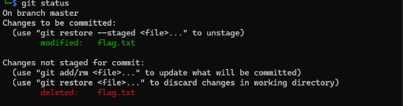  

得知flag被进行了一个删除，但其还是存在于暂存区，我们给他 `show` 出来即可，执行 `git show:flag.txt`

得到如下文本  
```text
flag is me,use base64 and put in moectf{}:ZzE3XzE1X3NvXzNhU3k=
```
按照它说的解一下base64，放到 `moectf{}`中，即可得到 flag

```tetx
moectf{g17_15_so_3aSy}
```

本题也有其他做法，比如 `git diff` 对比工作区和暂存区的文件，直接查看`flag.txt` 的内容

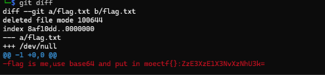

或者 `git restore` 进行回滚一下  

  

当然还有别的方法，这里不一一细讲了  

## 半部电台  

### Info
分数 : 100pts  
出题人 : linlin  
题目路径 : [半步电台](../../challenges/misc/半部电台/)

### Explain

本题为多附件动态flag，即每个选手分到的附件不一定一样，我们仅仅采取其中一个附件的内容进行题解的撰写  

拿到手只有一个wav文件，去了解相关的隐写手段后，我们得知一个技术——SSTV（慢扫描电视）

我们可以采取安装对应软件，配置虚拟声卡的方式来解码SSTV，但此处我们采取[在线网站](https://sstv-decoder.mathieurenaud.fr/)的形式  

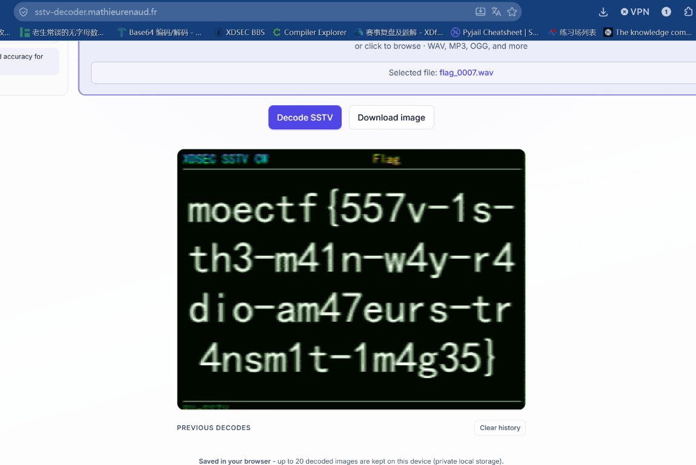

得到flag  

```
moectf{557v-1s-th3-m41n-w4y-r4dio-am47eurs-tr4nsm1t-1m4g35}
```

## 星走路的旅程-level2  

### Info
分数 : 100pts  
出题人 : starwalking  
题目路径 : [星走路的旅程-level2](../../challenges/misc/星走路的旅程-level2/)

### Explain

需要些许的注意力  

  

红色圈出来的的这一家商铺，在高德地图上进行搜索

得到的只有一家门店  


通过对这家万达其余商铺的对比，能确定近处的爷爷不泡茶和远处的刘一手火锅，印证找的地点是正确的  

flag为  

```text
moectf{JIANGSU_LIANYUNGANG_LINGZHOUDONGLU}
```

## 西复问答  

### Info
分数 : 100pts  
出题人 : 
- level 1 : PatriciaOfEnd
- level 2 : fanchai
- level 3 : starwalking  

题目路径 : [西复问答](../../challenges/misc/西复问答)

### Explain

#### level 1

从[西电地图网](https://map.xidian.cc/htmls/building_b.html)中能得知B楼的地图，确定1，2，3是可以进入的，4楼略有嫌疑  

但从[B站视频](https://www.bilibili.com/video/BV1VzywB6E8w/?spm_id_from=333.337.search-card.all.click&vd_source=a9e188e7400acbc9f4aa65890c7492f9)中也能看出来4楼可进入  

因此答案为 `10`

#### level2

从谷歌搜图中能得知，这是同济的衷和楼  


查看同济的[航拍](https://photo.tongji.edu.cn/tp/tpxq.htm?type=5&id=6391768d34b3d3b3d38f04510)  

进行建筑比对，可以确定拍摄的方向  

结合衷和楼玻璃幕墙，可以锁定在13层，我们也可以通过下面红色圈出的地方来进行二次确认  

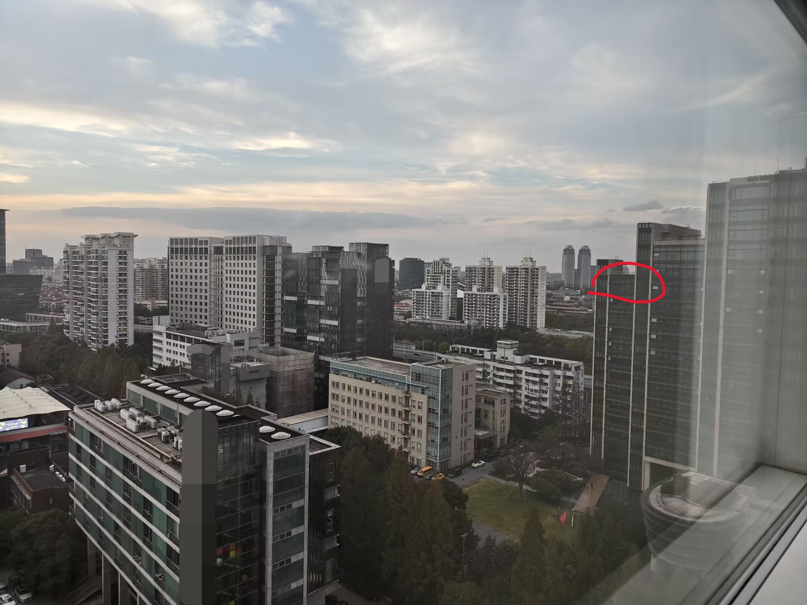

此处从下往上数为13楼，处于一个平视的角度

答案为 `同济大学衷和楼-13`

#### level3

从百度贴吧[帖子](https://tieba.baidu.com/p/8596935308?fr=undefined%29)可以看出  


发帖时间为2023-09-12，湖人发生时间为帖子发帖时间的昨天，即 2023-09-11  

前端文字出了问题，格式应该为 yyyymmdd,因此答案为 `20230911`

三题提交即可获取动态flag

## 霜雪千年  

### Info
分数 : 100pts  
出题人 : starwalking
题目路径 : [霜雪千年](../../challenges/misc/霜雪千年)

### Explain

题目得到一个压缩包，解开压缩包后还有压缩包，看情况要解压1000次，手动解压不太现实  

我们写个bash脚本命名为unpack.sh辅助操作    

```bash
#!/bin/bash
tmp=$(mktemp -d)
cp "$1" "$tmp/"
cd "$tmp"
f=$(basename "$1")
while :; do
    case "$f" in
        *.zip)   unzip -q "$f"; rm -f "$f"; f=$(ls);;
        *.7z)    7z x -y "$f" >/dev/null 2>&1; rm -f "$f"; f=$(ls);;
        *.tar.gz) tar -xzf "$f"; rm -f "$f"; f=$(ls);;
        *)       cat "$f" > "$OLDPWD/flag.txt"; rm -f "$f"; break;;
    esac
done
cd ..
rm -rf "$tmp"
```

执行 `./unpack.sh flag.zip`


得到解压后的 flag.txt 文件  

但是，flag.txt 里面除了六个字 `愿今生再相见` 就看不到可见字符了  

`xxd` 一下  

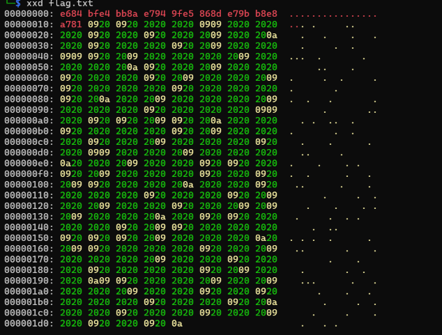  

发现实际还有很多的制表符和空格  

这其实是 `stegsnow` 的隐写特征  

我们需要知道密码，这个时候作为可见字符的六个字就其作用了  

这六个字是题目名称对应的歌曲的歌词，为最后一句上半段，那么密码自然可以猜测是下半段 `消融你眉间悲戚霜雪`  

`stegsnow -p "消融你眉间悲戚霜雪" flag.txt`  
解隐写即可得到flag  

```text
moectf{Sn0w_@lwa7s_h0lds_5tor7_w1thin}
```

需要注意的是，由于密码是中文，所以windows上可能存在编码问题，用 snow 的 windows 版本的同学不一定能解出，切换成 wsl 安装 stegsnow 即可  

## Wedge in the Wire  

### Info
分数 : 150pts  
出题人 : CloverDayssss  
题目路径 : [Wedge in the Wire](../../challenges/misc/Wedge%20in%20the%20Wire)

### Explain

分析流量特征可以知道，该包相关流量为 HTTP 协议流量，我们采取 http 作为我们的过滤器  

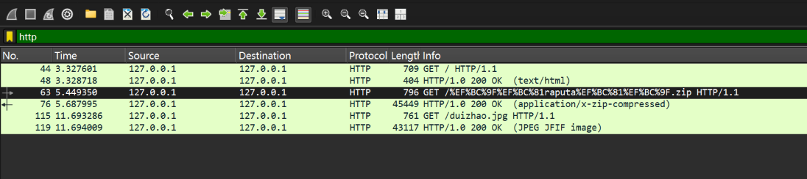  

可以看到有一个 zip 文件，和一个 jpg 文件，我们将其提取出来  

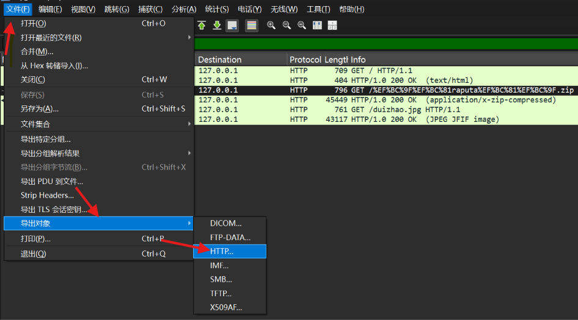  

解压压缩包存在两个文件，hint.txt 和 flag.png  

查看hint.txt 得知我们要更具 duizhaobiao.jpg 去翻译 flag 的内容  

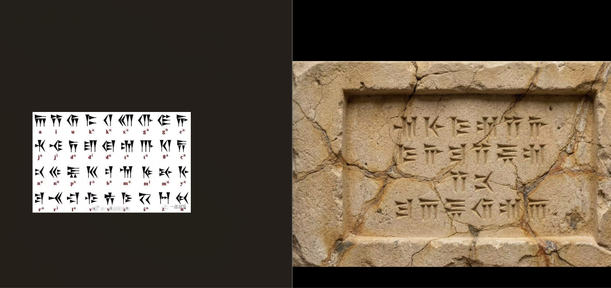

翻译得到flag  

```text
moectf{MYSTIC_SCRIPT_IN_RAPUTA}
```

## ez_keyboard  

### Info
分数 : 150pts  
出题人 : CloverDayssss  
题目路径 : [ez_keyboard](../../challenges/misc/ez_keyboard/)  

### Explain

分析可知这是一个usb流量，我们把usb流量提取出来，采用 `tshark` 进行提取，安装  `Wireshark`的时候一般会带的

`tshark -r keyboard.pcap -Y "usbhid.data" -T fields -e usbhid.data > usb.txt`

我们依据键盘流量的形式进行处理，写个python脚本

```python
normalKeys = {
    "04":"a", "05":"b", "06":"c", "07":"d", "08":"e", "09":"f", "0a":"g", "0b":"h", "0c":"i", "0d":"j", "0e":"k", "0f":"l",
    "10":"m", "11":"n", "12":"o", "13":"p", "14":"q", "15":"r", "16":"s", "17":"t", "18":"u", "19":"v", "1a":"w", "1b":"x",
    "1c":"y", "1d":"z",
    "1e":"1", "1f":"2", "20":"3", "21":"4", "22":"5", "23":"6", "24":"7", "25":"8", "26":"9", "27":"0",
    "28":"\n", "2c":" ",
    "2d":"-", "2e":"=", "2f":"[", "30":"]", "31":"\\",
    "33":";", "34":"'", "35":"`", "36":",", "37":".", "38":"/",
}

shiftKeys = {
    "04":"A", "05":"B", "06":"C", "07":"D", "08":"E", "09":"F", "0a":"G", "0b":"H", "0c":"I", "0d":"J", "0e":"K", "0f":"L",
    "10":"M", "11":"N", "12":"O", "13":"P", "14":"Q", "15":"R", "16":"S", "17":"T", "18":"U", "19":"V", "1a":"W", "1b":"X",
    "1c":"Y", "1d":"Z",
    "1e":"!", "1f":"@", "20":"#", "21":"$", "22":"%", "23":"^", "24":"&", "25":"*", "26":"(", "27":")",
    "28":"\n", "2c":" ",
    "2d":"_", "2e":"+", "2f":"{", "30":"}", "31":"|",
    "33":":", "34":"\"", "35":"~", "36":"<", "37":">", "38":"?",
}

text = []          # 已经输入的字符
cursor = 0         # 光标位置（方向键会移动它）
caps = False       # CapsLock 是否开启
last_keys = []     # 上一行按着的键

with open("usb.txt", "r") as f:
    lines = f.read().splitlines()

for line in lines:
    line = line.strip()
    if len(line) != 16:
        continue

    # 把 16 个字符拆成 8 个字节
    data = [int(line[i:i+2], 16) for i in range(0, 16, 2)]
    modifier = data[0]
    keys = [k for k in data[2:8] if k != 0]      # 本行按着的键码

    # 没有任何键码：全松开了（或只按着 Shift/Ctrl），清空"按着的键"
    if len(keys) == 0:
        last_keys = []
        continue

    # 过滤鼠标：鼠标流量前4字节恒为 0（后面是 x、y 位移）
    if data[2] == 0 and data[3] == 0:
        continue
    # Ctrl / Alt 等组合键（如 Ctrl+C）不是输入字符，跳过
    if modifier not in (0x00, 0x02, 0x20):
        continue

    # 只取"新按下"的键：上一行已经按着的键不重复计入
    # （n 还没松开时按下 i，报文里会同时出现 n 和 i）
    new_keys = [k for k in keys if k not in last_keys]
    last_keys = keys

    shift = (modifier != 0)
    for k in new_keys:
        if k == 0x39:                      # CapsLock
            caps = not caps
        elif k == 0x2a:                    # Backspace：删掉光标前一个字符
            if cursor > 0:
                cursor -= 1
                text.pop(cursor)
        elif k == 0x50:                    # 左方向键
            if cursor > 0:
                cursor -= 1
        elif k == 0x4f:                    # 右方向键
            if cursor < len(text):
                cursor += 1
        elif k == 0x4c:                    # Delete：删掉光标后一个字符
            if cursor < len(text):
                text.pop(cursor)
        elif k == 0x4a:                    # Home：光标移到行首
            cursor = 0
        elif k == 0x4d:                    # End：光标移到行尾
            cursor = len(text)
        else:
            code = "%02x" % k
            if 0x04 <= k <= 0x1d:          # 字母：Shift 和 CapsLock 同时用会抵消
                use_upper = (shift != caps)
            else:                          # 数字和符号：只看 Shift
                use_upper = shift
            table = shiftKeys if use_upper else normalKeys
            if code in table:
                text.insert(cursor, table[code])   # 在光标处插入
                cursor += 1

print("".join(text))

```

得到文本 

```text
fakeflag{typing begins in lowercase by default.}
moectf{w0w_y0u_c4n_r@4d_k3yb0ARD_7r@ffic}
finish.
```

## 一部电台  

### Info
分数 : 150pts  
出题人 : starwalking  
题目路径 : [一部电台](../../challenges/misc/一部电台/)  

### Explain

显然一听就是摩斯电码，我们采取[在线网站](https://www.morsedecode.xyz/zh)进行分析  

得到全部的摩斯电码如下  

```text
----- / ...-- / -.... / .---- / ..--- / ----. / --... / ...-- / -.... / .---- / ...-- / ....- / ----- / ..--- / ----- / --... / ----- / --... / ...-- / ..... / -.... / .---- / -.... / ---.. / ----- / ...-- / -.... / .---- / ..--- / ----. / --... / ...-- / ----- / -.... / ....- / ..... / ----- / ---.. / .---- / ----- / ..--- / ....- / .---- / --... / ..--- / ---.. / .---- / ....- / ----- / ...-- / -.... / .---- / ..--- / ----. / --... / ...-- / .---- / -.... / ..--- / --... / ....- / ..... / ---.. / ...-- / ----- / ...-- / -.... / .---- / ..--- / ----. / --... / ...-- / ----- / --... / ...-- / ..... / -.... / .---- / -.... / ---.. / ...-- / .---- / ..--- / --... / ...-- / .---- / .---- / ..--- / ..... / ..--- / -.... / .---- / ...-- / ----. / ....- / ..... / ----- / ...-- / -.... / .---- / ..--- / ----. / --... / ...-- / ----- / ...-- / -.... / .---- / ..--- / ----. / --... / ...-- / ...-- / .---- / ..--- / --... / ...-- / .---- / .---- / ..--- / ----- / -.... / ....- / ..... / ----- / ---.. / .---- / ----- / .---- / -.... / ..--- / --... / ....- / ..... / ---.. / ...-- / ..... / ..--- / -.... / .---- / ...-- / ----. / ....- / ..... / .---- / ...-- / ---.. / .---- / .---- / --... / ...-- / ----- / .---- / -.... / ..--- / --... / ....- / ..... / ---.. / ...-- / ----- / -.... / ....- / ..... / ----- / ---.. / .---- / ----- / ..--- / ....- / .---- / --... / ..--- / ---.. / .---- / ....- / ..... / ..--- / -.... / .---- / ...-- / ----. / ....- / ..... / ...-- / .---- / ..--- / --... / ...-- / .---- / .---- / ..--- / ...-- / .---- / ..--- / --... / ...-- / .---- / .---- / ..--- / ..--- / ....- / ..--- / ----. / ..--- / ....- / ----. / ....- / ----- / --... / ...-- / ..... / -.... / .---- / -.... / ---.. / ..... / ..--- / -.... / .---- / ...-- / ----. / ....- / ..... / ----- / ...-- / -.... / .---- / ..--- / ----. / --... / ...-- / ----- / -.... / ....- / ..... / ----- / ---.. / .---- / ----- / .---- / ----. / ....- / --... / ----- / ----. / ....- / ---.. / ----- / ...-- / -.... / .---- / ..--- / ----. / --... / ...-- / ..... / ..--- / -.... / .---- / ...-- / ----. / ....- / ..... / .---- / -.... / ..--- / --... / ....- / ..... / ---.. / ...-- / -.... / .---- / ...-- / ....- / ----- / ..--- / ----- / --... / .---- / -.... / ..--- / --... / ....- / ..... / ---.. / ...-- / ----- / ...-- / -.... / .---- / ..--- / ----. / --... / ...-- / ...-- / ----- / ....- / -.... / ----- / ----- / ...-- / .---- / ----- / ...-- / -.... / .---- / ..--- / ----. / --... / ...-- / ...-- / .---- / ..--- / --... / ...-- / .---- / .---- / ..--- / ----- / --... / ...-- / ..... / -.... / .---- / -.... / ---.. / ----- / --... / ...-- / ..... / -.... / .---- / -.... / ---.. / .---- / -.... / ..--- / --... / ....- / ..... / ---.. / ...-- / -.... / .---- / ...-- / ....- / ----- / ..--- / ----- / --... / .---- / -.... / ..--- / --... / ....- / ..... / ---.. / ...-- / ----- / --... / ...-- / ..... / -.... / .---- / -.... / ---.. / .---- / ...-- / ---.. / .---- / .---- / --... / ...-- / ----- / ----- / ...-- / -.... / .---- / ..--- / ----. / --... / ...-- / ----- / ...-- / -.... / .---- / ..--- / ----. / --... / ...-- / .---- / -.... / ..--- / --... / ....- / ..... / ---.. / ...-- / -.... / .---- / ...-- / ....- / ----- / ..--- / ----- / --... / .---- / -.... / ..--- / --... / ....- / ..... / ---.. / ...-- / ...-- / .---- / ..--- / --... / ...-- / .---- / .---- / ..--- / ..... / ..--- / -.... / .---- / ...-- / ----. / ....- / ..... / ----- / --... / ...-- / ..... / -.... / .---- / -.... / ---.. / ----- / --... / ...-- / ..... / -.... / .---- / -.... / ---.. / ----- / ...-- / -.... / .---- / ..--- / ----. / --... / ...-- / ----- / -.... / ....- / ..... / ----- / ---.. / .---- / ----- / ----- / ...-- / -.... / .---- / ..--- / ----. / --... / ...-- / ----- / ...-- / -.... / .---- / ..--- / ----. / --... / ...-- / .---- / -.... / ..--- / --... / ....- / ..... / ---.. / ...-- / ----- / ...-- / -.... / .---- / ..--- / ----. / --... / ...-- / ...-- / .---- / ..--- / --... / ...-- / .---- / .---- / ..--- / ...-- / .---- / ..--- / --... / ...-- / .---- / .---- / ..--- / ..--- / ....- / ..--- / ----. / ..--- / ....- / ----. / ....- / ----- / --... / ...-- / ..... / -.... / .---- / -.... / ---.. / ..... / ..--- / -.... / .---- / ...-- / ----. / ....- / ..... / ...-- / .---- / ..--- / --... / ...-- / .---- / .---- / ..--- / .---- / ...-- / ---.. / .---- / .---- / --... / ...-- / ----- / ----- / ...-- / -.... / .---- / ..--- / ----. / --... / ...-- / .---- / ----. / ....- / --... / ----- / ----. / ....- / ---.. / ----- / --... / ...-- / ..... / -.... / .---- / -.... / ---.. / ...-- / .---- / ..--- / --... / ...-- / .---- / .---- / ..--- / ...-- / .---- / ..--- / --... / ...-- / .---- / .---- / ..--- / ----- / -.... / ....- / ..... / ----- / ---.. / .---- / ----- / ...-- / .---- / ..--- / --... / ...-- / .---- / .---- / ..---
```

同样的网站进行解码  

```text
0 3 6 1 2 9 7 3 6 1 3 4 0 2 0 7 0 7 3 5 6 1 6 8 0 3 6 1 2 9 7 3 0 6 4 5 0 8 1 0 2 4 1 7 2 8 1 4 0 3 6 1 2 9 7 3 1 6 2 7 4 5 8 3 0 3 6 1 2 9 7 3 0 7 3 5 6 1 6 8 3 1 2 7 3 1 1 2 5 2 6 1 3 9 4 5 0 3 6 1 2 9 7 3 0 3 6 1 2 9 7 3 3 1 2 7 3 1 1 2 0 6 4 5 0 8 1 0 1 6 2 7 4 5 8 3 5 2 6 1 3 9 4 5 1 3 8 1 1 7 3 0 1 6 2 7 4 5 8 3 0 6 4 5 0 8 1 0 2 4 1 7 2 8 1 4 5 2 6 1 3 9 4 5 3 1 2 7 3 1 1 2 3 1 2 7 3 1 1 2 2 4 2 9 2 4 9 4 0 7 3 5 6 1 6 8 5 2 6 1 3 9 4 5 0 3 6 1 2 9 7 3 0 6 4 5 0 8 1 0 1 9 4 7 0 9 4 8 0 3 6 1 2 9 7 3 5 2 6 1 3 9 4 5 1 6 2 7 4 5 8 3 6 1 3 4 0 2 0 7 1 6 2 7 4 5 8 3 0 3 6 1 2 9 7 3 3 0 4 6 0 0 3 1 0 3 6 1 2 9 7 3 3 1 2 7 3 1 1 2 0 7 3 5 6 1 6 8 0 7 3 5 6 1 6 8 1 6 2 7 4 5 8 3 6 1 3 4 0 2 0 7 1 6 2 7 4 5 8 3 0 7 3 5 6 1 6 8 1 3 8 1 1 7 3 0 0 3 6 1 2 9 7 3 0 3 6 1 2 9 7 3 1 6 2 7 4 5 8 3 6 1 3 4 0 2 0 7 1 6 2 7 4 5 8 3 3 1 2 7 3 1 1 2 5 2 6 1 3 9 4 5 0 7 3 5 6 1 6 8 0 7 3 5 6 1 6 8 0 3 6 1 2 9 7 3 0 6 4 5 0 8 1 0 0 3 6 1 2 9 7 3 0 3 6 1 2 9 7 3 1 6 2 7 4 5 8 3 0 3 6 1 2 9 7 3 3 1 2 7 3 1 1 2 3 1 2 7 3 1 1 2 2 4 2 9 2 4 9 4 0 7 3 5 6 1 6 8 5 2 6 1 3 9 4 5 3 1 2 7 3 1 1 2 1 3 8 1 1 7 3 0 0 3 6 1 2 9 7 3 1 9 4 7 0 9 4 8 0 7 3 5 6 1 6 8 3 1 2 7 3 1 1 2 3 1 2 7 3 1 1 2 0 6 4 5 0 8 1 0 3 1 2 7 3 1 1 2
```

我们用 Audacity分析一下原始音频文件  

发现每四个解密出摩斯，间隔会从1秒跳到1.5秒，这让我们意识到原始密文或许为4个一组的格式，联想到电报  

我们采取[在线网站](https://telecodelookup.vercel.app/)解密电报得到  

```text
公正诚信和谐公正友善敬业公正平等公正和谐法治自由公正公正法治友善平等自由富强平等友善敬业自由法治法治文明和谐自由公正友善爱国公正自由平等诚信平等公正民主公正法治和谐和谐平等诚信平等和谐富强公正公正平等诚信平等法治自由和谐和谐公正友善公正公正平等公正法治法治文明和谐自由法治富强公正爱国和谐法治法治友善法治
```

再进行社会主义核心价值观解密即可，一样使用[在线网站](https://ctf.bugku.com/tool/cvecode)

得到flag  

```text
moectf{@_Gr4nd_ag3_0f_t3legr4ph7}
```

## 命运从未公平  

### Info
分数 : 150pts  
出题人 : starwalking  
题目路径 : [命运从未公平](../../challenges/misc/命运从未公平/)

### Explain

多次刷新抽奖解base64后，我们会发现一个hint，对应的抽奖结果如下  

```text
aGludDpmaXJzdF9jaGFyX2ZyZXd1ZW5jeQ==
```

解出来为

```text
hint:first_char_frewuency
```

其中 `frewuency` 我们认为是相近的单词  `frequency`

着告诉我们要对第一个字符进行词频分析，而提示的字符 `a` 显然不在我们的考虑之中，我们写如下脚本在提供的ssh服务内运行进行分析词频    

```python
import requests,re
from collections import defaultdict

URL = 'http://127.0.0.1:5000'
freq = defaultdict(int)
matches = re.compile(r'<div class="result">([^<]+)</div>')

for i in range(10000):
    if i % 100 == 0:
        print(i)

    response = requests.get(URL,timeout=5)
    message = matches.search(response.text)
    if message and(s := message.group(1).strip()):
        if s[0] == 'a':
            continue
        freq[s[0]] += 1
 
print(freq)
context = sorted(freq.items(),key = lambda x : x[1])

flag = f"moectf{{{''.join(k for k,v in context)}}}"

print(flag)
```

得到flag  

```text
moectf{Frequ3nc7IsC0oL}
```

## 星走路的黑历史  

### Info
分数 : 150pts  
出题人 : starwalking  
题目路径 : [星走路的黑历史](../../challenges/misc/星走路的黑历史)

### Explain

依据提题面，我们搜索这个QQ号  

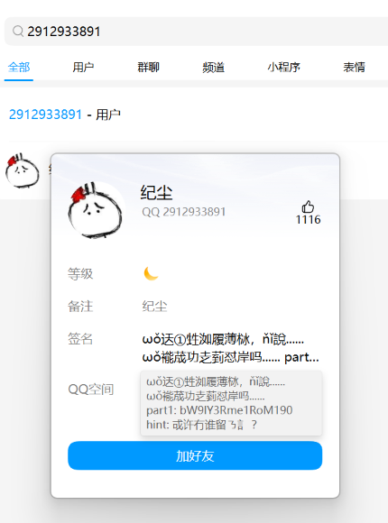

悬停在个性签名上发现了part1

```text
bW9lY3Rme1RoM190
```

根据此处的提示，我们去查看留言板  


只有一条 `快来抢沙发` 的信息  

我们将其复制下来，发现存在零宽字符  

为了完整复制，我们可以 `f12` 打开控制台，从中复制，如图  

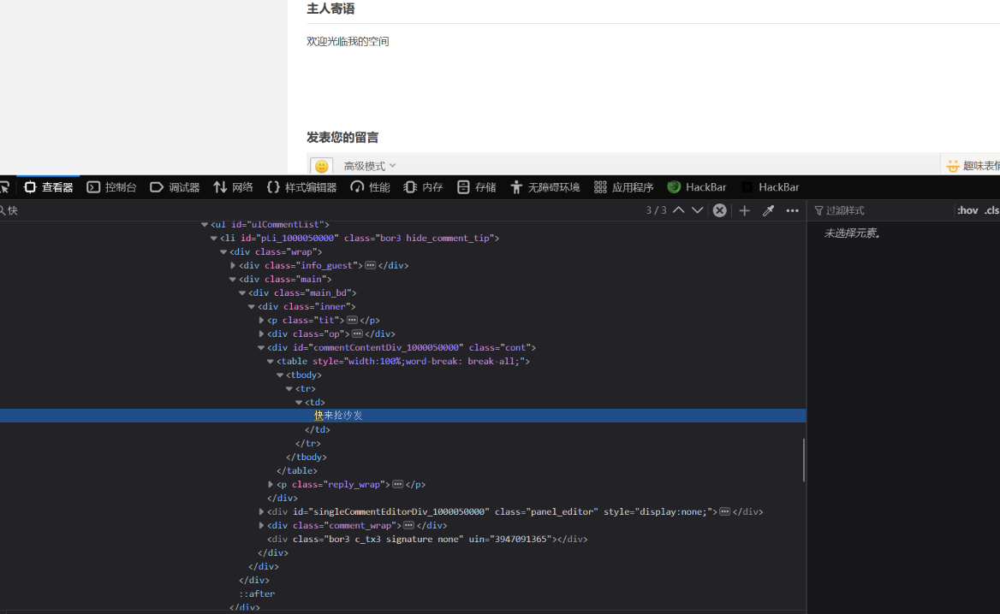

从[bfw工具箱](https://tool.bfw.wiki/tool/1695021695027599.html#google_vignette) 解零宽得到 part2

```text
part2: ckB2M2xfb2ZfMHMx
hint : see me
```

依据提示，我们发现留言的并不是提供的QQ号，只是名字，头像一致，我们访问这个留言者的空间  

此处我们切换至手机，查看其个人资料卡  

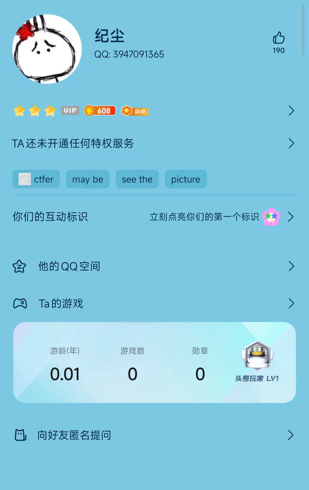

ps : 部分机型由于QQ支持不全，我们可以采取虚拟机的方式进行查看  

我们能看到在标签有 `ctfer`、`maybe`、`see the`、`picure` 字样，我们提取出图片  


隐约可以看文字，我们对其适当调整  

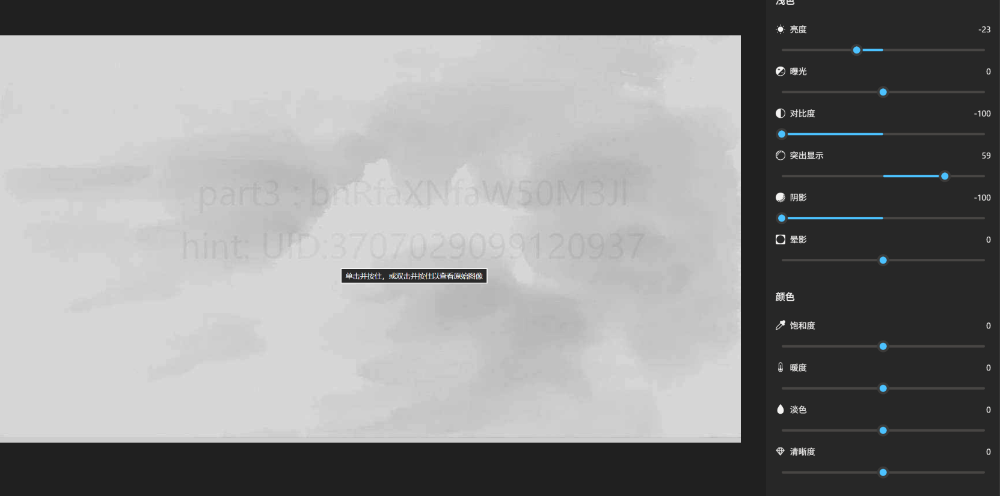

得到信息  

```text
part3 : bnRfaXNfaW50M3Jl
hint : UID:3707029099120937
```

分析这个UID，我们最终在bilibili找到了这个人  

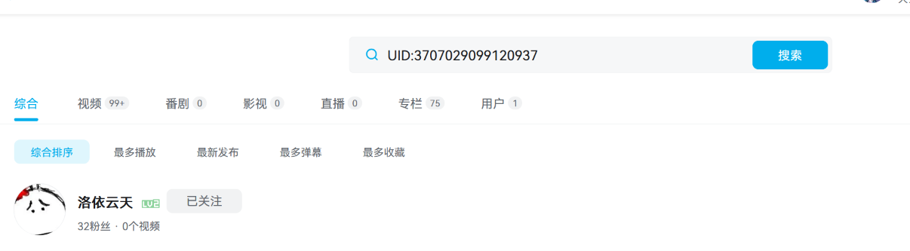

从动态下，我们看到了一张图片  


扫描二维码得到内容

```text
c3RpbjlfSEBoNCF9
```

不出意外的话这就是 part4 了

将其解base64拼接，得到flag  

```text
moectf{Th3_tr@v3l_of_0s1nt_is_int3restin9_H@h4!}
```

## 胡言乱语  

### Info
分数 : 150pts  
出题人 : xing  
题目路径 : [胡言乱语](../../challenges/misc/胡言乱语)

### Explain

分析流量，发现是被加密的 TLS 流量，我们需要尝试进行解密  

我们发现存在 tls.log  

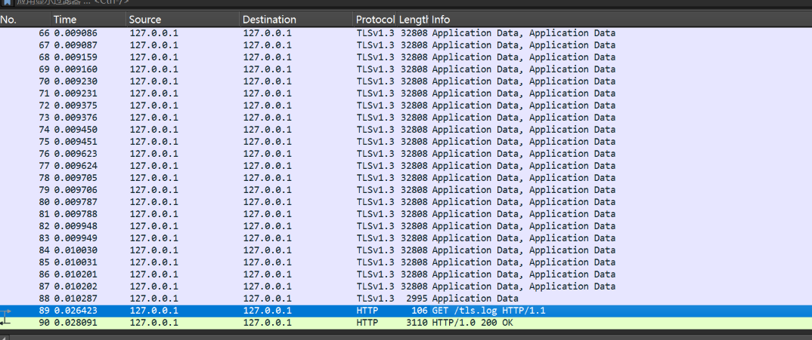  

导出，我们将其作为密钥解密 TLS 流量  

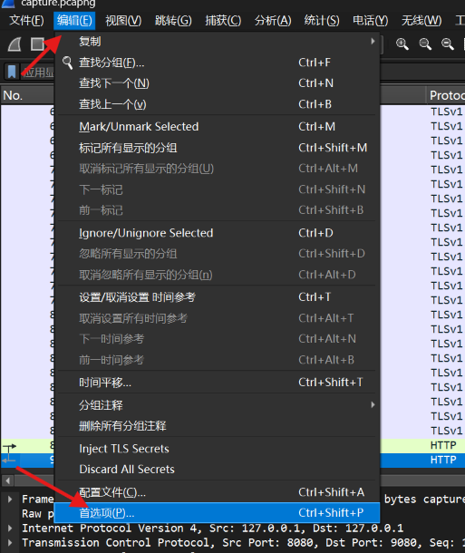  

在选项卡 `Protoclos` 中找到 tls 进行导入 tls 会话密钥   

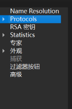

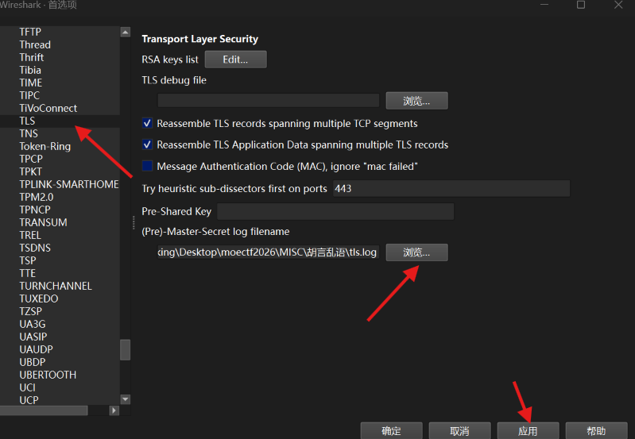  

我们发现解出来后，多了一个压缩包 

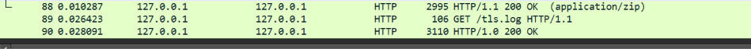  

我们将其导出  

如果单一压缩包保存不了，可以执行全部保存，保存后对压缩包进行重命名  

压缩包中仅含有一个png文件，且压缩包需要密码，依据题面，我们猜测其为四位密码，爆破即可  

采用 `ARCHPR(Advanced Archive Password Recovery)` 进行爆破，得到密码为`#9eA`  

解压得到一个png文件，依据题面压扁了的提示，我们猜测使用了宽高隐写，010进行恢复，我们直接把高拉长成一个较大值  

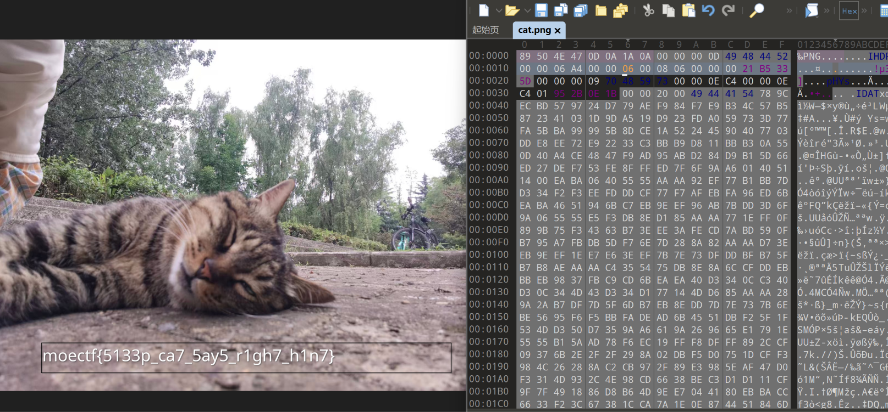

得到flag  

```text
moectf{5133p_ca7_5ay5_r1gh7_h1n7}
```

## kirakira  

### Info
分数 : 176pts  
出题人 : starwalking  
题目路径 : [kirakira](../../challenges/misc/kirakira)

### Explain

把压缩包拖进 010 查看，我们发现压缩包后还有数据，我们将其提取出来，用 `file` 命令得知，是一个 ppm 文件，重命名为 `file.ppm`,如图所示  

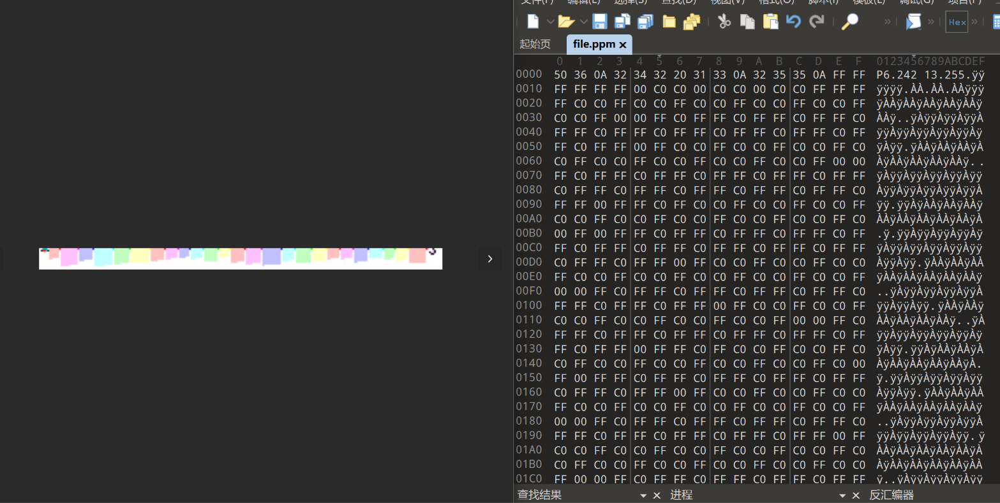

经过查询，我们知道有种 esolang 以图片为载体，我们访问[在线网站](https://www.bertnase.de/npiet/npiet-execute.php)去运行这张图片  

得到结果  

```text
&i;uUc<-"-@!DUo5QA,,B0(5Z
```

我们将其作为密码对 hanabi.jpg 解隐写，尝试发现是 `outguess`，得到 AI 侧的信物 和本题的 flag

```text
moectf{I_w1ll_ch3ri5h_0ur_mennor7}
```

附加挑战 ： 信物 2 的获取

压缩包还有一个文件 ZodiacSigns.txt 没被使用到过，翻译一下，结合日期，我们能认为和星座相关，ZodiacSign.txt 解 base64 可以得到对照符号  

```
SHIFT
1.ARI
2.TAU
3.GEM
4.CNC
5.LEO
6.VIR
7.LIB
8.SCO
9.SGR
0.CAP
-.AQR
=.PSC
KEYBOARD
```

依据SHFFT和KEYBOARD的提示，我们猜测对键盘上的 `1234567890-=` 进行 shift，得到的字符为 `!@#$%^&*()_+`  

搜索可知，这也是一门 esolang，我们翻译日期，得到需要运行的文件  

我们将日期提取出来命名为 dates.txt 方便我们解析  

采取如下脚本  

```python
NUM_TO_CHAR = {
    1: '!', 2: '@', 3: '#', 4: '$', 5: '%', 6: '^',
    7: '&', 8: '*', 9: '(', 10: ')', 11: '_', 12: '+',
}

# 把日期写成 月*100+日 的整数，例如 3月21日 -> 321，12月22日 -> 1222
# 每一项是 (起始, 结束, 星座编号)，日期必须严格落在起始和结束的开区间之间，避免歧义
ZODIAC_RANGES = [
    (321, 419, 1),    # 白羊座
    (420, 520, 2),    # 金牛座
    (521, 621, 3),    # 双子座
    (622, 722, 4),    # 巨蟹座
    (723, 822, 5),    # 狮子座
    (823, 922, 6),    # 处女座
    (923, 1023, 7),   # 天秤座
    (1024, 1122, 8),  # 天蝎座
    (1123, 1221, 9),  # 射手座
    (1222, 1232, 10), # 摩羯座（年底部分）
    (100, 119, 10),   # 摩羯座（年初部分）
    (120, 218, 11),   # 水瓶座
    (219, 320, 12),   # 双鱼座
]


def find_zodiac_num(date_str):
    """输入 'MM.DD'，返回对应的星座编号（1-12）。"""
    month, day = date_str.split('.')
    value = int(month) * 100 + int(day)

    for start, end, num in ZODIAC_RANGES:
        if start < value < end:
            return num

    raise ValueError(f"日期 {date_str} 不在任何星座的范围内")


def decrypt_dates(text):
    """把一串日期（逗号、空格或换行分隔）还原成符号字符串。"""
    dates = text.replace(',', ' ').split()
    result = ''
    for date_str in dates:
        num = find_zodiac_num(date_str)
        result += NUM_TO_CHAR[num]
    return result


if __name__ == '__main__':
    with open('dates.txt') as f:
        data = f.read()
    dec = decrypt_dates(data)
    print("还原出的符号字符串:", dec)
    with open('1.txt','w') as f:
        f.write(dec)
```

得到结果  

```text
**!!!_+%(%!%+%_^_)+$@!^*!!_+%(%!%+%_^_)+!%+*@_*_!!_+^^#@^!!#_^#*!+!+^^^!!_+*!!_+%(%!%+%_^_)+!_++@*!^^^^$_^^_!!_+%(%!%+%_^_)+!_+^^^!!++!!_+%(%!%+%_^_)++_^_@*!!_+*!!+$^^^^^$!!_+&+!!_+%(%!%+%_^_)&_^_!+@!!+!+$*!!_+%(%!%+%_^_)+!_++_^_@*_^^_!*!!_+%(%!%+%_^_)++!!_+^^^_!!+$!^^_&+_!!_+%(%!%+%_^_)++*@*!^^^$_^^$!!_+%(%!%+%_^_)+*_*!!_+&!_@+_!@*!*$@!!@^^$!!_+^^!+!+!++@!@_*_!*@@*!!_+*!!_+%(%!%+%_^_)!^^^^!+!+!!_+!&$&+$(%!%+%_^_)++^@*!!++!!_+*!+!!_+%(%!%+%_^_)++@
```

把之前解密隐写的密码作为输入传递给程序  

此处我们采取github上的一个项目[ecndpcaalrlp](https://github.com/ConorOBrien-Foxx/ecndpcaalrlp)，用于运行程序  

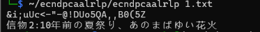

得到结果  

```
信物2:10年前の夏祭り、あのまばゆい花火
```

## 基米文件  

### Info
分数 : 200pts  
出题人 : starwalking  
题目路径 : [基米文件](../../challenges/misc/基米文件)

### Explain

题目是一个压缩包，直接解压，我们能看到一个 hachimi.txt 文件，但用010打开，我们实际能看到有个 fix.yaml 也应该在压缩包当中  

因为原来的压缩包删除了中央目录区，导致正常解压看不到，这里我们采取 7z，使用 `7z x hachimi.zip` 即可正常解压获取到文件，fix.yaml 文件内容如下  

```yaml
method: insert
index: 618
char: 200b
key: hachimi
author: xiaobaozi
comment: 啊啊啊啊啊饱饱你是一个变量，常量，数据类型，整型，浮点型，字符型，布尔型，数组，字符串，结构体，联合体，枚举，指针，引用，运算符，算术运算符，关系运算符，逻辑运算符，位运算符，赋值运算符，表达式，语句类，对象，属性，方法，封装，继承，多态，抽象类，接口，重载，覆盖，泛型，模板，异常，错误处理，调试，断点，数组，链表，单链表，双链表，循环链表，栈，队列，顺序队列，循环队列，优先队列，树，二叉树，二叉搜索树，平衡二叉树，红黑树，堆，大顶堆，小顶堆，图，顶点，边，有向图，无向图，邻接矩阵，邻接表，深度优先搜索，广度优先搜索，哈希表，散列表，哈希函数，冲突解决，开放地址法，链地址法，算法，时间复杂度，空间复杂度，冒泡排序，选择排序，插入排序，希尔排序，归并排序，快速排序，堆排序，计数排序，桶排序，基数排序，查找算法，顺序查找，二分查找，哈希查找，动态规划，贪心算法，分治算法，回溯算法，白盒测试，黑盒测试，灰盒测试，回归测试，压力测试，性能测试，冒烟测试，极限编程，瀑布模型，螺旋模型，垃圾回收，引用计数，标记清除，分代收集，内存泄漏，缓冲区溢出，空指针，野指针，序列化，反序列化，密钥管理，密钥交换，遗传算法，遗传编程，蚁群算法，单例模式，工厂模式，抽象工厂模式，建造者模式，原型模式，适配器模式，桥接模式，组合模式，装饰器模式，外观模式，享元模式，代理模式，责任链模式，命令模式，解释器模式，迭代器模式，中介者模式，备忘录模式，观察者模式，发布订阅模式，状态模式，策略模式，模板方法模式，访问者模式，空对象模式，规格模式，依赖注入，控制反转，面向切面编程，断言，单元测试，集成测试，端到端测试，健全测试，探索性测试，硬件令牌，软件令牌，生物识别，指纹识别，量子算法，，数字签名迁移，密钥交换迁移，证书体系更新，密码敏捷性，密码破解，暴力破解，字典攻击，彩虹表，侧信道攻击香香软软的小蛋糕啊
```

我们搜索一下这个author，发现一个哈基米加密解密工具  

  

将hachimi.txt 的内容作为明文，fix.yaml中的key作为密钥进行解密

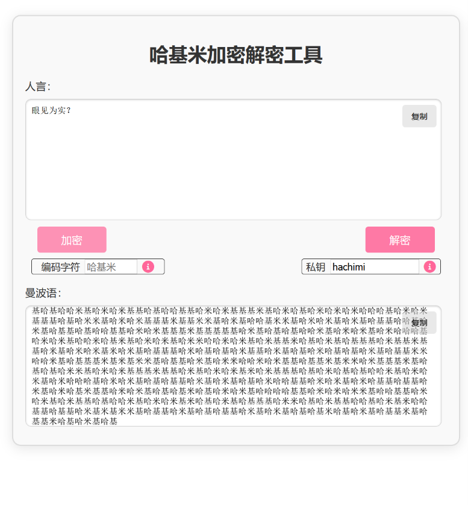  

解密的内容很短，我们怀疑存在零宽  

但直接解密我们发现是一个fakeflag  

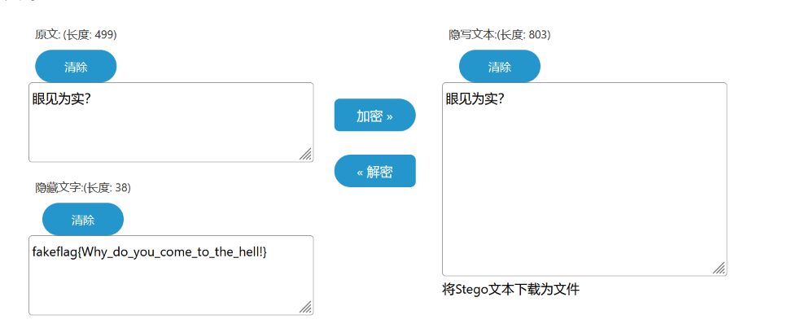  

而且发现解密出来的原文长度明显不对劲，我们将之前解密出来的内容存储到 `cipher.txt`，在python里面进行set去重，得到如下结果  

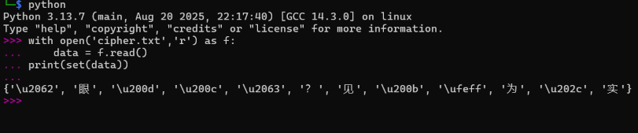  

我们看到不止4种零宽字符，实际存在7种，原理在于，解零宽时，只会识别我们勾选的零宽，因此，我们进行一个反向选择，只选择先前没用到的内容  

解密后得到的flag好像并不全，后面有乱码  

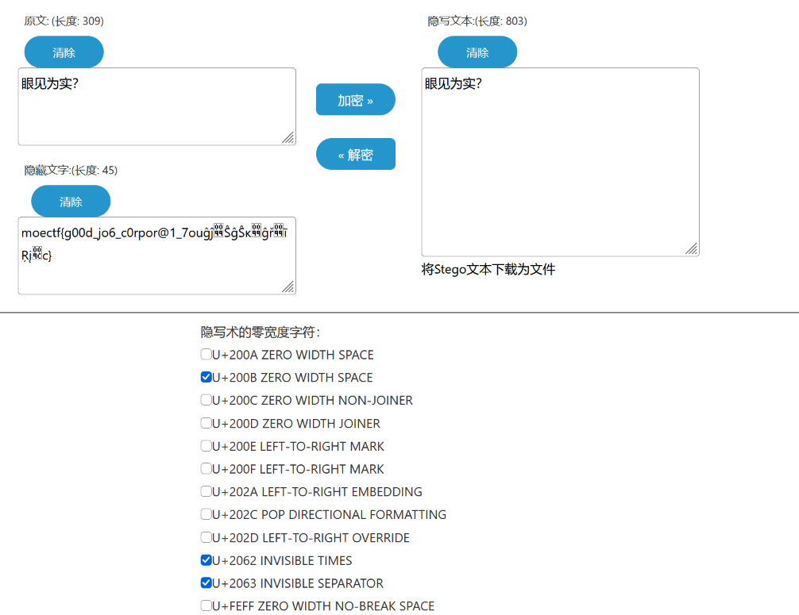

我们看看 `fix.yaml` 还有什么没用到的字段

comment 无用，还剩下method,char,index 三个字段，这提示我们要对原始明文进行修复，在618处去插入一个 u200B 的零宽字符，我们采取如下脚本进行修复  

```python
with open('cipher.txt') as f:
    data = f.read()

data = data[:618] + '\u200b' + data[618:]
with open('data.txt','w') as f:
    f.write(data)
```

将修复的文件再次进行零宽解密，我们就得到了flag  

```text
moectf{g00d_jo6_c0rpor@1_7ou_g3t_th3_s3cre4!}
```

## 星走路的旅程-level3  

### Info
分数 : 200pts  
出题人 : starwalking  
题目路径 : [星走路的旅程-level3](../../challenges/misc/星走路的旅程-level3)

### Explain

先辨认对面飞机的注册号  


能隐约看出来是B-6376  

我们查看原始图片的属性，发现有hint，提示我们去flightaware查询

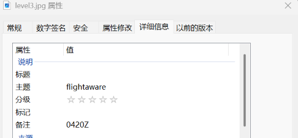

但当我们想查询过往历史的时候，我们发现只能溯源前三个月的  

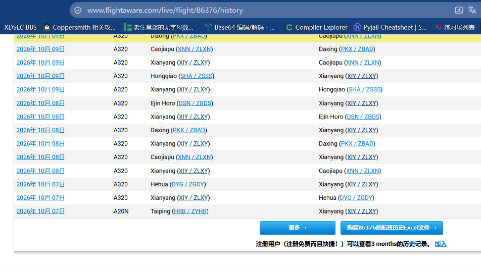  

我们点进去查看，可以发现其实它的路由格式是差不多的  

```text
https://www.flightaware.com/live/flight/B6376/history/20261007/0635Z/ZYHB/ZLXY
```

history后紧接着的是日期以及起飞机场和着陆机场的ICAO代号  

而实际上，我们知道日期即可查询  

但我们从属性只能精确到日期为20260427，具体时间其实并不知道，查看属性中的备注，为我们补齐了后半段0420Z，因此我们拼接一下，即可得到查询链接  

```
https://www.flightaware.com/live/flight/B6376/history/20260427/0420Z
```

得知这是一架从西安咸阳国际机场`(XIY)` 起飞，福州长乐国际机场 `(FOC)` 着陆的飞机，航班号为 `MU2137`  

flag 为  

```text
moectf{XIY_MU2137_FOC}
```

## 魔理沙偷走了重要的东西  

### Info
分数 : 200pts  
出题人 : CloverDayssss  
题目路径 : [魔理沙偷走了重要的东西](../../challenges/misc/魔理沙偷走了重要的东西)

### Explain  

解压文件，我们发现这个png文件疑似有点过大了，足足 680 KB，我们用 `binwalk` 进行查看  

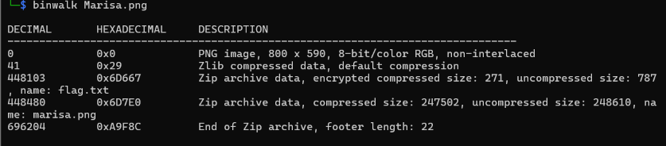

发现存在 zip 文件，我们用得知文件zip从0x6D667开始，我们 010 定位查看一下  

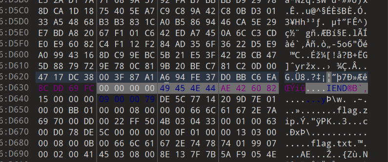  

发现在png的IEND结束后，0x6D667 之前还有zip的数据，我们分析可以得知，压缩包是破损的，我们需要补上504B0304的PK头并分离二者，我们采取如下python脚本分离

```python
with open('Marisa.png','rb') as f:
    data = f.read()

iend = data.find(b'IEND')
end = iend + 8

png = data[:end]
zip = b'\x50\x4b\x03\x04' + data[end:]

with open('pure.png','wb') as f:
    f.write(png)

with open('pure.zip','wb') as f:
    f.write(zip)
```

解压zip文件我们得到了两个文件 flag.zip 和 marisa.png  

对 marisa.png 进行 zsteg 进行 lsb 隐写分析，我们得到了flag.zip 的第一段密码  

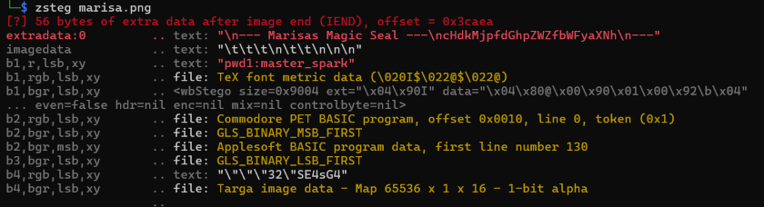

```text
pwd1:master_spark
```


同时还告诉我们有56字节的数据在文件尾，我们 `tail -c 56 marisa.png` 查看一下，得到了数据  

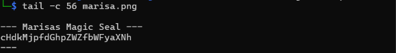

```text
--- Marisas Magic Seal ---
cHdkMjpfdGhpZWZfbWFyaXNh
---
```

解base64 得到第二段密码  

```text
pwd2:_thief_marisa
```

得到的flag.zip 的密码为 `master_spark_thief_marisa`

解压查看flag.txt 的内容，如下  

```text
Marisas Hidden Treasure!
+++++ +++++ [->++ +++++ +++<] >++++ +++++ .++.< +++[- >---< ]>-.- -.<++
++[-> ++++< ]>+.< +++[- >---< ]>--- --.<+ +++[- >++++ <]>++ +++.< +++[-
>---< ]>--- --.<+ +++++ +[->- ----- -<]>- ----- --.<+ +++++ +[->+ +++++
+<]>+ +++++ +++++ ++.-- ----- --.<+ ++[-> +++<] >+.<+ +++[- >---- <]>--
.--.< +++++ +[->- ----- <]>-- ----- ---.< +++++ +++[- >++++ ++++< ]>++.
<++++ [->-- --<]> ----. <++++ [->++ ++<]> +++++ .<+++ [->-- -<]>- --.--
-.--- ---.+ ++.<+ +++++ [->-- ----< ]>--- ----- ---.< +++++ +++[- >++++
++++< ]>.+. <++++ [->-- --<]> ----- .<+++ +[->+ +++<] >++++ +.<++ +[->-
--<]> ---.< +++++ ++[-> ----- --<]> ----- -.++. <++++ +++[- >++++ +++<]
>++.- ----- -.+++ ++.-- -.<++ +++[- >++++ +<]>. <++++ [->-- --<]> -----
.<+++ +[->+ +++<] >++++ ++++. <
```

显然是一段 brainfuck，我们找[在线解释器](https://brainfuck.net/)运行  

得到flag  

```text
moectf{m4risa_1s_the_b3st_th13f_daze}
```