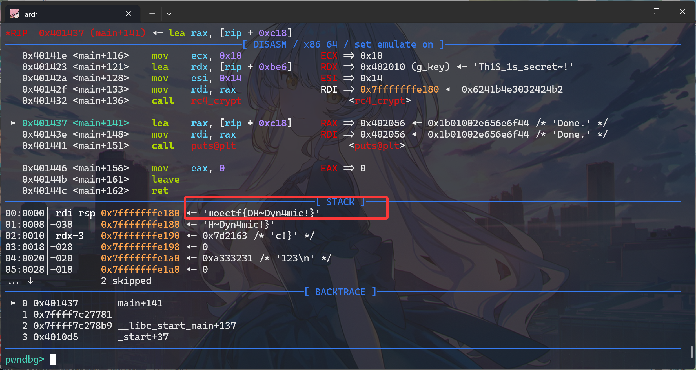

## Mewtype

去混淆 + z3 solver。本题用 [λ Calculus](https://esolangs.org/wiki/Lambda_calculus) 混淆的思路来自 [LilacCTF 2026](https://github.com/sajjadium/ctf-archives/tree/main/ctfs/LilacCTF/2026/rev/lambdam) 的同款神题。预期解是观察用到常数的部分手动分离出表达式，用 z3 solver 求解。AI 表示也可以写一个 parser 把整个代码丢进 z3。本来只是想出个 z3 题，主逻辑就是几个二次方程的约束，但是在已知 flag 头的情况下会被轻松爆破出 flag，所以加了点混淆防止一眼看出，但最后也没能很好的解决爆破的问题（悲）。话说回来，只要是图灵完备的运算都可以用来混淆，但是 λ Calculus 可以轻松的把长度膨胀到不可读的地步，或许是相比 NAND 类运算的优势？可惜的是如果把数字也变成 Church 数的话会导致这个代码轻松爆栈无法验证正确性，所以最后没有这么做（真这么做了还能防爆破，但是感觉就过于恶心了）。

## 反方向的RC4

### 信息收集

ELF64 动态链接、未 strip，符号 `g_key` / `g_cipher` / `init_cipher` / `rc4_crypt` 一目了然。`.rodata` 里两段数据：

* `g_key = "Th1S_1s_secret~!"`（16 字节）
* `g_cipher = b2 24 24 03 e3 b4 41 62 11 f3 8a 28 a0 71 9b be 27 46 19 a9`（20 字节）

### 程序逻辑

`main` 干四件事：


1. `fgets` 读入 0x15 字节 （读完就丢）；
2. `init_cipher` 把 `g_cipher` 拷到栈上；
3. `rc4_crypt(buf, 0x14, g_key, 0x10)` 对缓冲区做原地变换；
4. 打印 `Done.`。

### 解法

`rc4_crypt` 就是教科书 RC4（KSA + PRGA），用同一算法再跑一遍即得明文：

```python
key = b"Th1S_1s_secret~!"
ct  = bytes.fromhex("b2242403e3b4416211f38a28a0719bbe274619a9")
​
S = list(range(256)); j = 0
for i in range(256):
    j = (j + S[i] + key[i % len(key)]) & 0xFF
    S[i], S[j] = S[j], S[i]
​
i = j = 0; pt = bytearray()
for c in ct:
    i = (i + 1) & 0xFF; j = (j + S[i]) & 0xFF
    S[i], S[j] = S[j], S[i]
    pt.append(c ^ S[(S[i] + S[j]) & 0xFF])
print(pt.decode())
```

动态调试也可以：gdb 断在 `rc4_crypt` 返回之后栈上就有 `flag`。



### Flag

`moectf{OH~Dyn4mic!}`

## Tell Me No Lies

### 程序逻辑

`main` 依次做三件事：


1. **检测反调试** `IsDebuggerPresent()`：打开 `/proc/self/status`，逐行找 `TracerPid:` 前缀并 `strtoul` 其数值，非 0 即返回 1，`main` 直接退出。
2. **令牌校验**：
   * `build_required_token` 把 `.rodata` 中 20 字节数组异或 `0x5A`，得到 `"MOE-LEVEL-7-OPERATOR"`；
   * `acquire_operator_token` 却只根据 `getpid() & 1` 返回 `"MOE-LEVEL-1-GUEST"` 或 `"MOE-LEVEL-3-TECH"`。
   * 两者永远不可能相等，对应题目描述中的 “再让那场注定失败的校验归于通过”。
3. **解密** `self_driven_decrypt(dbgp, cmp_result, out)`。

### 关键点：检查结果就是密钥

`self_driven_decrypt` 内部对 `g_packed_flag`（32 字节）依次逆运算：

```c
seed = derive_root_seed(dbgp, cmp_result);
undo_permutation(buf, seed);     // xorshift32 驱动的 Fisher-Yates 逆置换
rc4_transform(buf, 32, seed);    // 标准 RC4，密钥 derive_bytes(seed, 0xdeadbeef, 16)
xtea_cbc_decrypt(buf, seed);     // 标准 XTEA(32 轮) CBC，密钥/IV 由 seed 派生
rolling_arx_decrypt(buf, seed);  // 逐字节 keystream 异或 + rotr8 + 减法
if (buf[31] != 0) return 0;                                // 要求 NUL 结尾
if (fnv1a32(buf, 31) != 0x7329c3ed) return 0;              // FNV-1a 完整性校验
```

也就是说，反调试与令牌检查的结果被当作密钥输入传进了解密器：**两项都"通过"（值均为 0）时**种子为 `derive_root_seed(0, 0) = 0x62cc696f`，解出的 32 字节恰好通过末尾 NUL 与 FNV-1a 双重校验。所以这道题的正解就是绕过这两个"看门人"，让它们返回 0。

### 解法

**gdb 脚本动调**：


1. `b main` —— 停在反调试执行之前；
2. patch `IsDebuggerPresent` 为 `xor eax,eax; ret`；
3. patch `0x401e28` 处的 `call compare_operator_token` 为 `xor eax,eax`；
4. 在 `printf("%s")` 之后、`memset` 清栈之前断下，dump `rbp-0x50`。

```python
import gdb

def patch(addr: int, data: bytes) -> None:
    gdb.selected_inferior().write_memory(addr, data)
    print(f"[*] patched {addr:#x} <- {data.hex()}")

# 先停在 main 入口，此时还没有执行反调试检测
gdb.execute("break main")
gdb.execute("run")

# IsDebuggerPresent -> xor eax,eax; ret
patch(0x401256, bytes.fromhex("31c0c3909090"))

# 0x401e28: call compare_operator_token -> xor eax,eax
patch(0x401E28, bytes.fromhex("31c0909090"))

# 在 printf 输出 flag 之后、memset 清空之前停住
gdb.Breakpoint("*0x401ebd")
gdb.execute("continue")

inf = gdb.selected_inferior()
addr = int(gdb.parse_and_eval("$rbp - 0x50"))
raw = bytes(inf.read_memory(addr, 32))
flag = raw.split(b"\x00", 1)[0].decode(errors="replace")
print(f"[+] flag: {flag}")

gdb.execute("quit")
```

静态也可以解出，不过这里明显 patch 起来更简单。

## Flag

`moectf{Wow~h0w_do_Y0u_f1nd_IT?}`