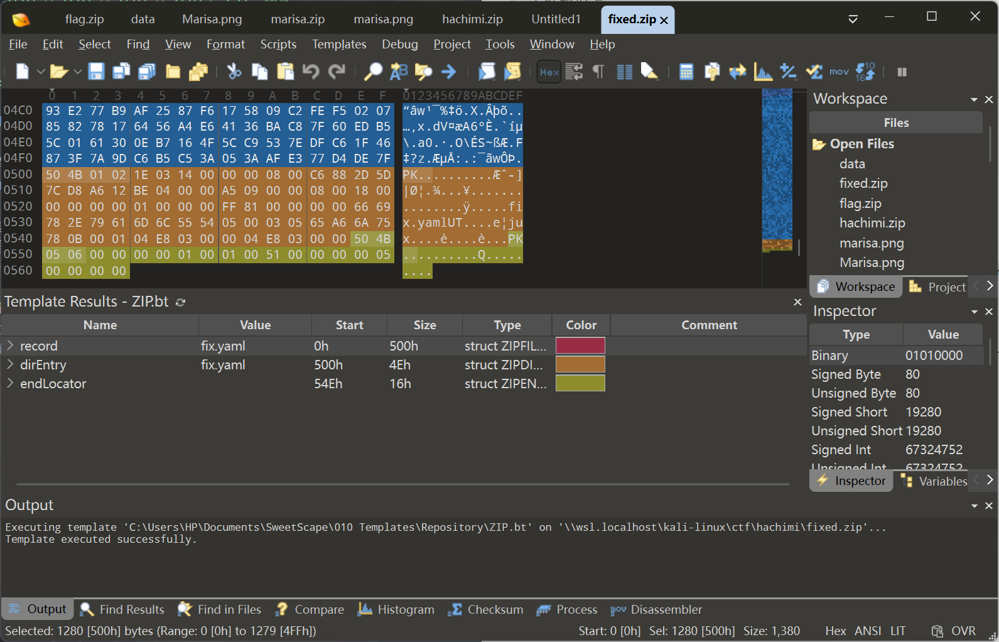
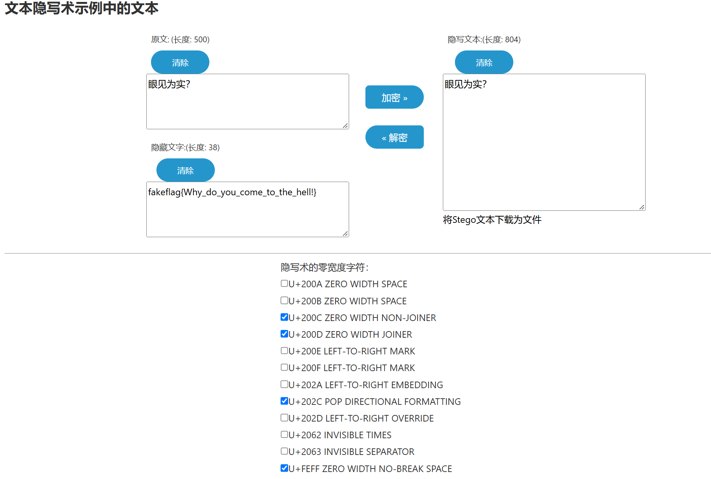
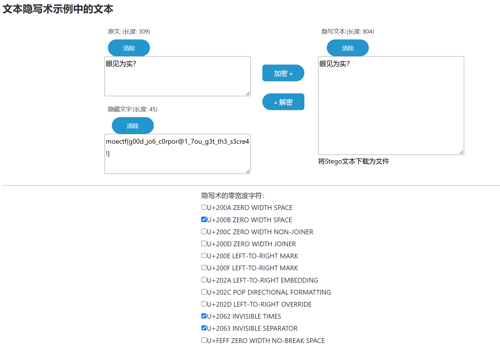

# 基米文件 - WriteUp

> 本题知识点：  
> :star::star: 十六进制分析  
> :star::star::star::star: ZIP 格式  
> :star::star::star::star::star: ZIP 修复  
> :star::star::star::star: 两段零宽字符隐写  
> :star::star::star: 工具查找能力
>
> 综合难度： :star::star::star::star::star:

## ZIP 修复

拿到手的只有一个 `hachimi.zip`，解压后只有一个由`哈基米`组成的 `hachimi.txt`。这堆文本目前无从下手，所以先研究一下压缩包。

将压缩包扔进十六进制编辑器，发现有两段 ZIP 头。  
其中，第二段 ZIP 头和后面的数据组成了一个完整的 ZIP 结构，只多出来了前面的一个头部。

将头部数据截取出来，手动补上中央和尾部。  
可以借鉴第二段的完整结构中的中央区和尾部。  
修复好的数据如下：



> [!NOTE]
> 蓝色的是截取出的头部，橙色和黄色都是手动补上的数据，结构可以参考 `hachimi.zip`

修复好之后解压，得到 `fix.yaml`。

## 解码

`fix.yaml` 内容如下：

```yaml
method: insert
index: 618
char: 200b
key: hachimi
author: xiaobaozi
comment: 啊啊啊啊啊饱饱你是一个变量，常量，数据类型，整型，浮点型，字符型，布尔型，数组，字符串，结构体，联合体，枚举，指针，引用，运算符，算术运算符，关系运算符，逻辑运算符，位运算符，赋值运算符，表达式，语句类，对象，属性，方法，封装，继承，多态，抽象类，接口，重载，覆盖，泛型，模板，异常，错误处理，调试，断点，数组，链表，单链表，双链表，循环链表，栈，队列，顺序队列，循环队列，优先队列，树，二叉树，二叉搜索树，平衡二叉树，红黑树，堆，大顶堆，小顶堆，图，顶点，边，有向图，无向图，邻接矩阵，邻接表，深度优先搜索，广度优先搜索，哈希表，散列表，哈希函数，冲突解决，开放地址法，链地址法，算法，时间复杂度，空间复杂度，冒泡排序，选择排序，插入排序，希尔排序，归并排序，快速排序，堆排序，计数排序，桶排序，基数排序，查找算法，顺序查找，二分查找，哈希查找，动态规划，贪心算法，分治算法，回溯算法，白盒测试，黑盒测试，灰盒测试，回归测试，压力测试，性能测试，冒烟测试，极限编程，瀑布模型，螺旋模型，垃圾回收，引用计数，标记清除，分代收集，内存泄漏，缓冲区溢出，空指针，野指针，序列化，反序列化，密钥管理，密钥交换，遗传算法，遗传编程，蚁群算法，单例模式，工厂模式，抽象工厂模式，建造者模式，原型模式，适配器模式，桥接模式，组合模式，装饰器模式，外观模式，享元模式，代理模式，责任链模式，命令模式，解释器模式，迭代器模式，中介者模式，备忘录模式，观察者模式，发布订阅模式，状态模式，策略模式，模板方法模式，访问者模式，空对象模式，规格模式，依赖注入，控制反转，面向切面编程，断言，单元测试，集成测试，端到端测试，健全测试，探索性测试，硬件令牌，软件令牌，生物识别，指纹识别，量子算法，，数字签名迁移，密钥交换迁移，证书体系更新，密码敏捷性，密码破解，暴力破解，字典攻击，彩虹表，侧信道攻击香香软软的小蛋糕啊
```

`comment` 是注释的意思，除去 `comment` 外**都**是有用的信息。

这里貌似想让我们在 618 的位置插入一个 `U+200B`（零宽空格），但是原文件里没有任何零宽字符，所以应该不是直接插入。

原文件应该是某种三进制编码，需要我们先**解码**。这里给的 `key` 也暗示我们这是某种编码。`author` 似乎与**编码工具**有关。查一下：


很明显，第一个就是了。去解码一下。


## 零宽隐写

```plaintext
‌​‌​‌​‌​‍​‬​‍⁢‬⁢‌​‌​‌⁢‌​‍​‬​‌​‍​‌​‌⁢‌⁢‌​‍⁢‬​‬​​‌​‌​‌​‌​‍⁢‬​‍⁣‍​‌⁣‌​‌​‌​‍​‬​‍​‬⁢‌​‌⁣‌​‌​‍​‬​​‌​‌​‌​‌⁢‌⁢‍​‬⁣‌⁣‍​‌​‌​‌​‌​‍​‬⁢‍​⁣‌⁢‌​‌​‌​‍​​‬​​眼⁢见⁢为⁢实⁣‌​‌​‌​‌​‍​‍​‍​⁢‌​‌⁣‌⁢‌⁢‍​‬​‬​‌​‌​‌​‌​‌⁢‍⁣⁢‬​‍​‌​‌​‌​‌​‍​‍​⁢⁣‌⁢‌​‌​‌​‍​‬​‍​‌​‌⁢‌​‌⁣‌​‍⁢‬​​​‌​‌​‌​‌⁢‍​‍⁢⁢⁣‌​‌​‌​‌​‍​​‬⁢‍​‌⁣‌⁣‌⁢‌​‍​‬​​​‌​‌⁢‌⁢‌​‍⁢​‍​‍​‌​‌​‌​‌​‍​‍⁣​​‌​‌​‌​‌​‍​‬​‌​⁢‌​‌⁢‌⁢‌⁣‍​‬​​​‌​‌​‌⁢‌​‍⁣‬​​‍​‌​‌​‌​‌​‍​‬​‍⁢‍⁣‌⁢‌​‌​‌​‍​‍​​​‌⁢‌⁢‌​‌⁣‍​​‍​‌​‌​‌​‌​‌⁢‍⁢‬​⁢⁢‌​‌​‌​‌​‍​‍​⁢⁢‌​‌⁢‌​‌​‍​​‍​‌​‌​‌⁢‌⁢‌​‍⁣‬​‬​‌​‌​‌​‌​‌​‍​‬⁣‍⁢‍​？⁢‌​‌​‌​‌​‍​‍​​⁢‌⁣‌⁢‌⁢‌​‍​‬​‬​‌​‌​‌⁢‌​‌⁢‍⁢‬⁣‍​‍​‌​‌​‌​‌​‍​‬⁣​‌​‌⁢‌​‌​‌​‍​‬​​‌⁢‌⁢‌​‌⁢‌​‌​‬​‌​‍​‌​‌​‌⁢‌⁢‍⁢​​‍​​​​​⁢​⁢⁢⁣​​​​​​⁢​⁣⁢⁢​​​​​​​⁢⁣⁣​​​​​​​⁢⁢​⁣⁣​​​​​​⁢​⁢⁢⁣​​​​​​⁢⁢​⁣⁣​​​​​​⁢​⁣⁢⁣​​​​​​​⁢⁣⁣​​​​​​​⁢​⁢⁢⁣​​​​​​⁢⁢​⁣⁢​​​​​​​⁢⁣⁣​​​​​​​⁢​⁣​​​​​​​​⁢⁢​⁣​​​​​​​⁢​⁣​⁣​​​​​​​⁢⁣⁣⁢​​​​​​​⁢​⁣​​​​​​​⁢⁢⁢⁣⁣
```

这是一段相当可疑的文本。结合*眼见为实*的提示，不难发现这里有许多零宽字符。（贴 vscode 里也能直接看出来）

看来就是要在这里插入 `U+200B` 了。写一段 python 脚本：

```python
with open('result.txt') as f:
    s = list(f.read())
    s.insert(618, chr(0x200B))
    open('result.2.txt', 'w').write(''.join(s))
    counter = {}
    for i in map(lambda x: f'U+{hex(ord(x))[2:].upper().rjust(4, "0")}', s):
        counter[i] = counter.setdefault(i, 0) + 1
    for k, v in counter.items():
        print(f'{k}: {v}')
```

:large_blue_circle: [hachimi.py](../code/utilities/misc/hachimi.py)

> [!NOTE]
> 这里我将这段文本存在了 `result.txt` 中，将处理后的存入 `result.2.txt`，并且统计一下各字符数量。

跑出的结果如下：

```plaintext
U+200C: 166
U+200B: 347
U+200D: 68
U+202C: 33
U+2062: 98
U+FEFF: 37
U+2063: 50
U+773C: 1
U+89C1: 1
U+4E3A: 1
U+5B9E: 1
U+FF1F: 1
```

> [!NOTE]
> 最后5个字符是 `眼见为实？` 的 UNICODE，需要忽略掉。

在网上找一个零宽字符解码器，直接解码，发现拿到了 **假flag**。



结合上面统计的字符信息，不难想到，原文可能是两段零宽隐写。为了避免相互干扰，用了两套**完全不重合**的零宽字符集。

那么我们要做的，就是把所有出现过的隐写字符全部勾上，再把图上这 4 种去掉。

很顺利地拿到了真正的 flag！



    moectf{g00d_jo6_c0rpor@1_7ou_g3t_th3_s3cre4!}