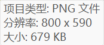
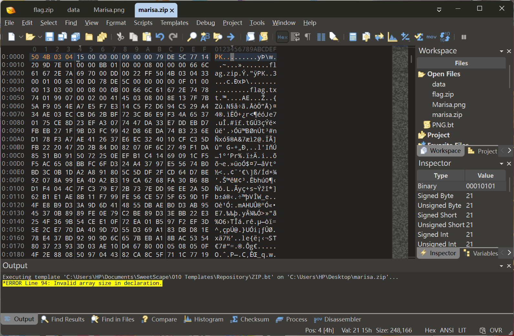
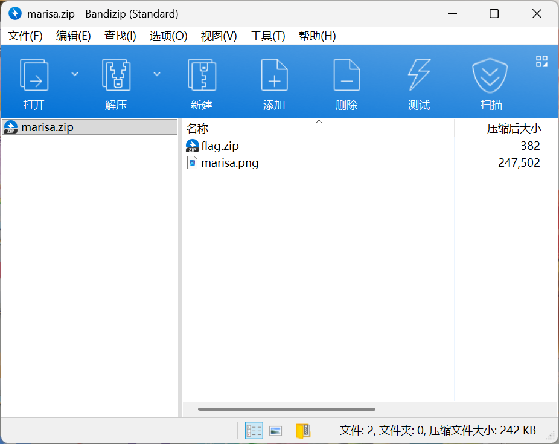
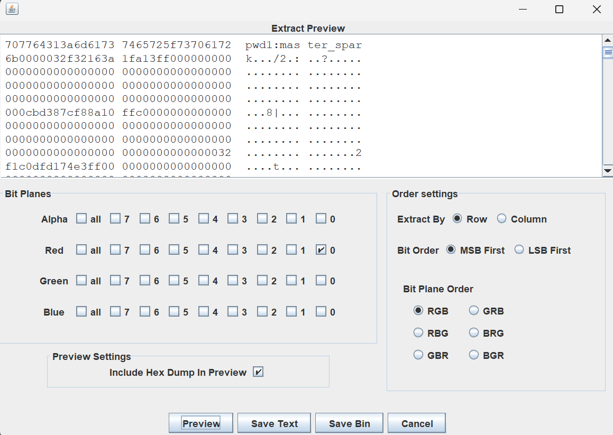
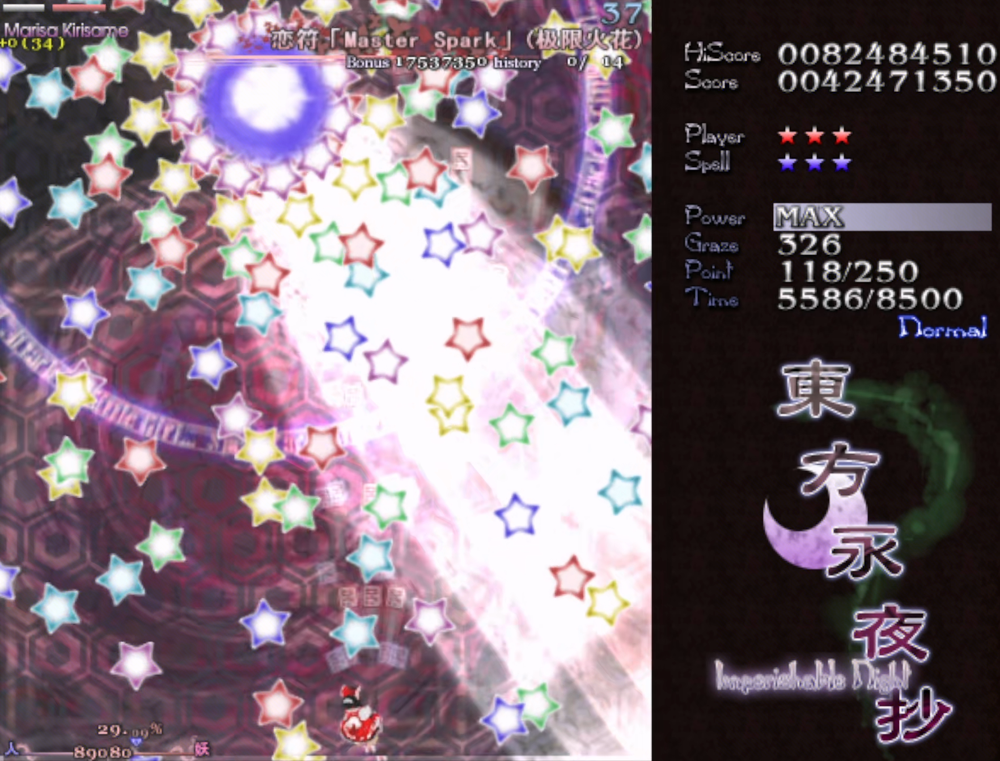
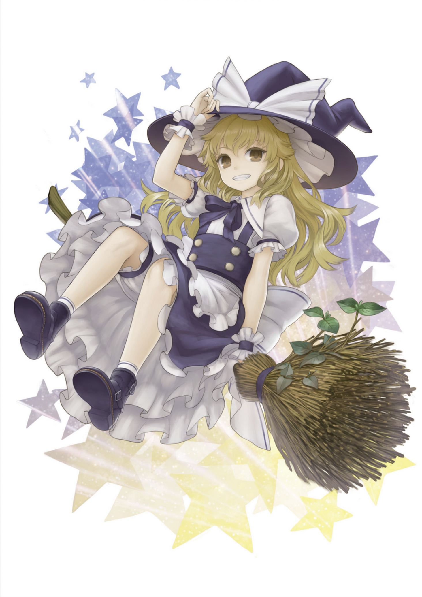

# 魔理沙偷走了重要的东西 - WriteUp

> 本题知识点：  
> :star: 十六进制分析  
> :star::star: PNG 格式  
> :star::star::star::star: ZIP 格式  
> :star::star::star::star::star: ZIP 修复  
> :star::star::star: 图片 LSB 隐写提取
>
> 综合难度： :star::star::star::star::star:

## 分析

### ZIP 提取与修复

拿到图片，发现文件大小相当不对劲。



推测图片里藏了压缩包。

用十六进制编辑器打开，发现 PNG 数据的尾部后有数据，全部另存到另一个文件。


对截取的数据进行分析，找到了 `flag.zip` `PK..` 等字样，猜测是 ZIP 数据。从尾部开始分析，追踪偏移值，发现数据正好缺少了一个 ZIP 头部的 `50 4B 03 04`，补上后尝试打开。





其中，`flag.zip` 是加密的。

### 图片分析

将第二张 marisa.png 用十六进制编辑器打开，发现图片末尾有关键数据：

    --- Marisas Magic Seal ---
    cHdkMjpfdGhpZWZfbWFyaXNh
    ---

看起来是 base64 编码，解码后得到

    pwd2:_thief_marisa

看起来不像压缩包密码，pwd2 似乎表明这是密码的第二段。

用 StegSolve 打开，发现在 Red 通道的最低位有 LSB 隐写数据。



    pwd1:master_spark

**恋符 「Master Spark」（极限火花）** ~~（东方厨狂喜）~~



## 解 flag

把两段拼起来：

    master_spark_thief_marisa

两段拼在一起之后尝试，密码正确，拿到了 flag.txt

```brainfuck
Marisas Hidden Treasure!
+++++ +++++ [->++ +++++ +++<] >++++ +++++ .++.< +++[- >---< ]>-.- -.<++
++[-> ++++< ]>+.< +++[- >---< ]>--- --.<+ +++[- >++++ <]>++ +++.< +++[-
>---< ]>--- --.<+ +++++ +[->- ----- -<]>- ----- --.<+ +++++ +[->+ +++++
+<]>+ +++++ +++++ ++.-- ----- --.<+ ++[-> +++<] >+.<+ +++[- >---- <]>--
.--.< +++++ +[->- ----- <]>-- ----- ---.< +++++ +++[- >++++ ++++< ]>++.
<++++ [->-- --<]> ----. <++++ [->++ ++<]> +++++ .<+++ [->-- -<]>- --.--
-.--- ---.+ ++.<+ +++++ [->-- ----< ]>--- ----- ---.< +++++ +++[- >++++
++++< ]>.+. <++++ [->-- --<]> ----- .<+++ +[->+ +++<] >++++ +.<++ +[->-
--<]> ---.< +++++ ++[-> ----- --<]> ----- -.++. <++++ +++[- >++++ +++<]
>++.- ----- -.+++ ++.-- -.<++ +++[- >++++ +<]>. <++++ [->-- --<]> -----
.<+++ +[->+ +++<] >++++ ++++. <
```

除去第一行，这是一个 brainfuck 程序，在网上找一个解释器，运行一下，得到 flag。

```
moectf{m4risa_1s_the_b3st_th13f_daze}
```

200pts 到手啦 DA☆ZE

