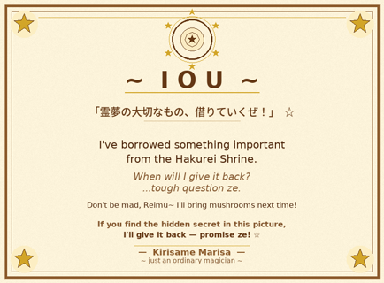
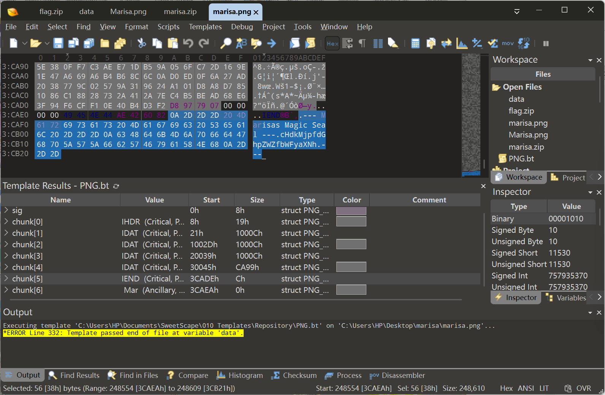

# 魔理沙偷走了重要的东西 - 灵梦视角 WriteUp

> 本题知识点：  
> :star: 十六进制分析  
> :star::star: PNG格式  
> :star::star::star::star: ZIP格式  
> :star::star::star: ZIP头修复  
> :star::star::star: 图片 LSB 隐写提取
>
> 综合难度： :star::star::star::star::star:


## Stage 1 ~ 空掉的赛钱箱

博丽神社的秋天很安静，安静到能听见落叶砸在赛钱箱上的声音。

那天早上我去查看赛钱箱——本来也没什么好查看的，毕竟里面从来只有空气和我的叹息。可这一次，空气的味道不对：我藏在箱底暗格里、用御札封了九重的那件"重要的东西"，不见了。

地上留着一张便条。




    ~ 借条 ~

    「灵梦最重要的东西，我就借走啦！」 ☆

    我从博丽神社借走了一些重要的东西。
    什么时候还回去呢？
    ……这问题可真难回答 ZE。

    别生气嘛，灵梦~ 下次我会带蘑菇来的！
    如果你能找出这张图里的隐藏秘密，
    我就把它还给你——我保证 ZE！ ☆

    —— 雾雨魔理沙 ——
    ~ 一个普通的魔法使 ~


……"借"。

幻想乡的规矩我懂：魔理沙说"借"，就是"再也见不到"；她写"下一次"，就是"永远没有下一次"。至于"带蘑菇来道歉"——她那些从魔法森林里采回来的蘑菇，我一口都不会碰。上次的教训还留在我的茶杯里，那玩意儿是魔法材料，不是食物。

不过有一句话我记下了：

> **如果你能找出这张图里的隐藏秘密，我就把它还给你——我保证 ZE！ ☆**

她把话说得很明白——**秘密藏在这张图里**，那我就把它找出来！

## Stage 2 ~ 尺寸不对的图片

先把便条和神社里那几张她留下的大图都过了一遍。图本身倒没什么稀奇，直到我看见属性：


**PNG，800 × 590，679 KB。**

一张这个尺寸的图，正常也就一百多 KB。679 KB，沉得不像话。凭直觉我就知道：**里面藏了东西。** 我的直觉，一直都是很准的。

这种把戏我见多了——魔理沙最喜欢把偷来的东西塞进图片里，因为这样看起来就只是一张普通的图。按霖之助的说法，这叫"数据伪装"，香霖堂里那些来路不明的道具也常这么干。

我抱着图去了香霖堂，借他那台号称"能看穿一切"的鉴定镜——也就是人类村落里说的十六进制编辑器。

镜面一开，图的真身就露了出来：图片数据尾部（PNG 的 `IEND` 标记）之后，还跟着一大段不属于图片的内容。


> **【做法】** 用十六进制编辑器打开图片，定位 PNG 结束标记 `IEND`，把它之后的全部字节另存成一个新文件。

东西被塞进了"境界的缝隙"里。这种手法，八云紫那家伙大概会眯着眼睛笑一笑，说一句"真有意思"。

## Stage 3 ~ 碎掉的封印

截出来的那段数据，翻着翻着就露出了马脚：明明白白写着 `flag.zip`，还有 `PK..` 这样的字样。

是压缩包。她把偷走的东西装进 ZIP，再塞进图里。

但封印被她自己弄坏了——**数据开头缺了一个 ZIP 文件头 `50 4B 03 04`**。就像一道符只画了半个字，自然什么也召唤不出来。我沿着数据尾部往回追踪偏移值，确认了这个事实，然后把那四个字节补了回去。


> **【做法】** 在截出的数据最前面补上 `50 4B 03 04`，另存为 `marisa.zip`，即可正常打开。

封印立起来之后，里面躺着两样东西：


- `marisa.png`——247,502 字节，她的"自画像"
- `flag.zip`——只有 382 字节，整个包里最小、也最扎眼的一件东西

整个 `marisa.zip` 一共 242 KB。而我一眼就看见，`flag.zip` **是加密的**。

好你个魔理沙，偷东西还上锁。

## Stage 4 ~ 封印的咒文

第二轮，我把目标换成了 `marisa.png`。同样用鉴定镜打开，在文件末尾，我看见了她亲手刻下的"魔法封印"：




    --- Marisas Magic Seal ---
    cHdkMjpfdGhpZWZfbWFyaXNh
    ---


幻想乡没人不认识 base64。那是魔法使之间传话的常用手段，据说是从外界流进来的东西，霖之助研究过好一阵子。我把它解出来：

    pwd2:_thief_marisa

只有第二段。`pwd2` 这个前缀摆明了是挑衅：**咒文有两句，你慢慢找吧。**

## Stage 5 ~ 最低位的低语

懂魔法的人都知道，咒文的第一句总藏在最不起眼的地方。我把图片丢进 StegSolve——帕秋莉说过，颜色也是有"元素"的，红绿蓝三通道各说各话，而**最低位**是最安静的角落。

将**红色通道**的**最低位**提取出来，便拿到了第一句


> **【做法】** 将解压的 marisa.png 扔进 StegSolve 里分析 LSB 隐写

    70 77 64 31 3A 6D 61 73 74 65 72 5F 73 70 61 72 6B
    → pwd1:master_spark

**恋符 「Master Spark」（极限火花）**

……那是她最有名的招式。拿这个当密码，还真是她的风格。还记得当年，我们因为[一场异变](https://touhou.review/%E4%B8%9C%E6%96%B9%E6%B0%B8%E5%A4%9C%E6%8A%84)而交过手。这张符卡的超高威力也确实给我留下了最深刻的印象。


## Final Stage ~ 重要的东西

两句咒文，按顺序接起来：

    master_spark_thief_marisa

我把这段咒文按在 `flag.zip` 的锁上。咔哒一声，那 382 字节里封着的东西开了——`flag.txt`。

里面是一长串由 `+ - < > [ ] . ,` 组成的文字。阿求——或者慧音老师，反正她们都爱研究古怪的东西——管这个叫 **brainfuck**：一种只剩八个符号的咒语，人类和妖怪都读得懂，只要你肯一行一行地听它说话。

```brainfuck
Marisas Hidden Treasure!
+++++ +++++ [->++ +++++ +++<] >++++ +++++ .++.< +++[- >---< ]>-.- -.<++
++[-> ++++< ]>+.< +++[- >---< ]>--- --.<+ +++[- >++++ <]>++ +++.< +++[-
>---< ]>--- --.<+ +++++ +[->- ----- -<]>- ----- --.<+ +++++ +[->+ +++++
+<]>+ +++++ +++++ ++.-- ----- --.<+ ++[-> +++<] >+.<+ +++[- >---- <]>--
.--.< +++++ +[->- ----- <]>-- ----- ---.< +++++ +++[- >++++ ++++< ]>++.
<++++ [->-- --<]> ----. <++++ [->++ ++<]> +++++ .<+++ [->-- -<]>- --.--
-.--- ---.+ ++.<+ +++++ [->-- ----< ]>--- ----- ---.< +++++ +++[- >++++
++++< ]>.+. <++++ [->-- --<]> ----- .<+++ +[->+ +++<] >++++ +.<++ +[->-
--<]> ---.< +++++ ++[-> ----- --<]> ----- -.++. <++++ +++[- >++++ +++<]
>++.- ----- -.+++ ++.-- -.<++ +++[- >++++ +<]>. <++++ [->-- --<]> -----
.<+++ +[->+ +++<] >++++ ++++. <
```

第一行是她的留言——"Marisas Hidden Treasure!"，魔理沙的宝物。这个自恋的家伙。

除去这一行，剩下的就是一段完整的咒文。我在香霖堂把它念了一遍（霖之助在旁边按[计算器](https://brainfuck.net/)），flag 浮了出来：

```
moectf{m4risa_1s_the_b3st_th13f_daze}
```

